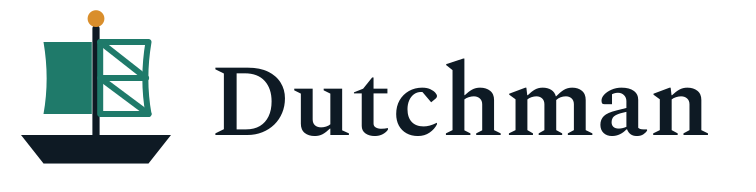

<h1>
  <picture>
    <source media="(prefers-color-scheme: dark)" srcset="assets/logo/dutchman-lockup-night.png">
    <source media="(prefers-color-scheme: light)" srcset="assets/logo/dutchman-lockup.png">
    
  </picture>
</h1>

Dutchman converts native CAD designs into open, editable models. Reading the native file is
done by [cadmpeg](https://github.com/cadmpeg/cadmpeg); Dutchman maps cadmpeg's model onto a
target format, starting with [SolidCraft](https://github.com/tangency-labs/solidcraft) designs.

```sh
dutchman convert part.f3d part.solidcraft
```

Early development. Fusion (`.f3d`) designs convert today:

- When every feature in a design's history maps onto SolidCraft (sketches and extrudes so
  far), the SolidCraft design keeps that history, editable, with the original geometry kept
  beside it. If `solidcraft-cli` is installed, Dutchman replays the history in it and checks
  it against the original before keeping it.
- Otherwise the design converts as solid geometry without history.
- Every conversion lists what it could not carry across, as Info, Degraded or Dropped.

`dutchman convert --help` lists the options.

See [docs/ARCHITECTURE.md](docs/ARCHITECTURE.md) for how it fits together.

## Building

```sh
cargo build --release
cargo test --workspace
```

## Licence

Licensed under the [Apache License, Version 2.0](LICENSE).
