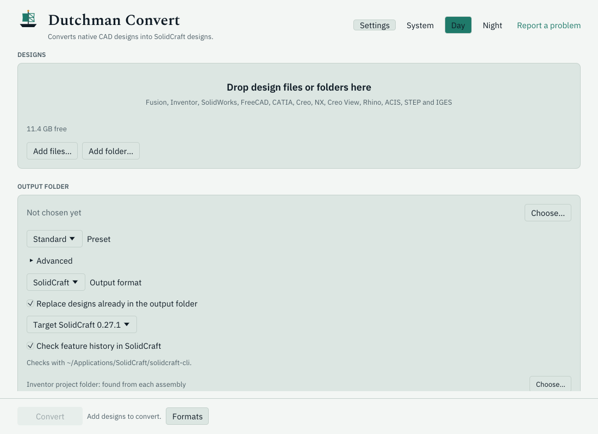
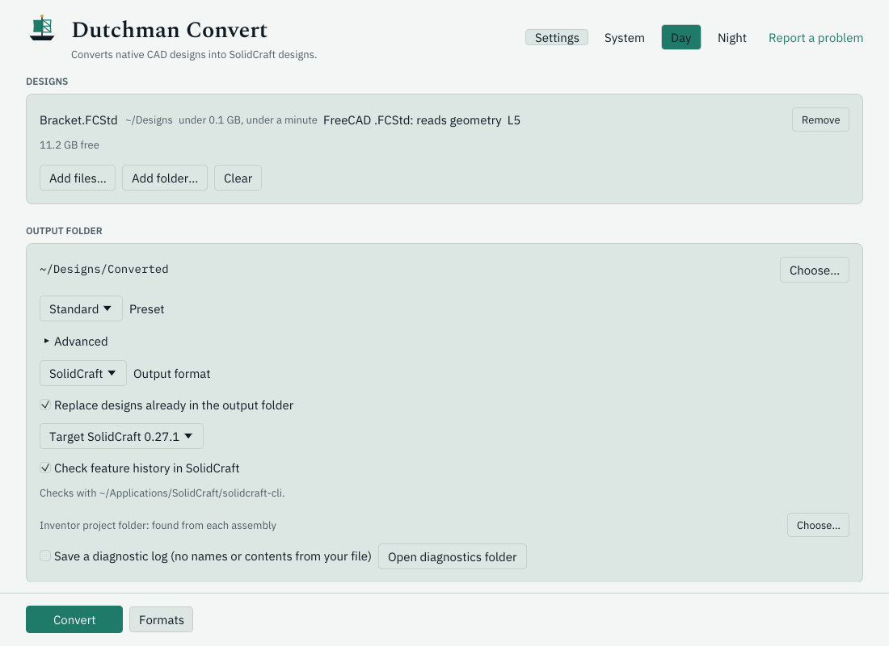
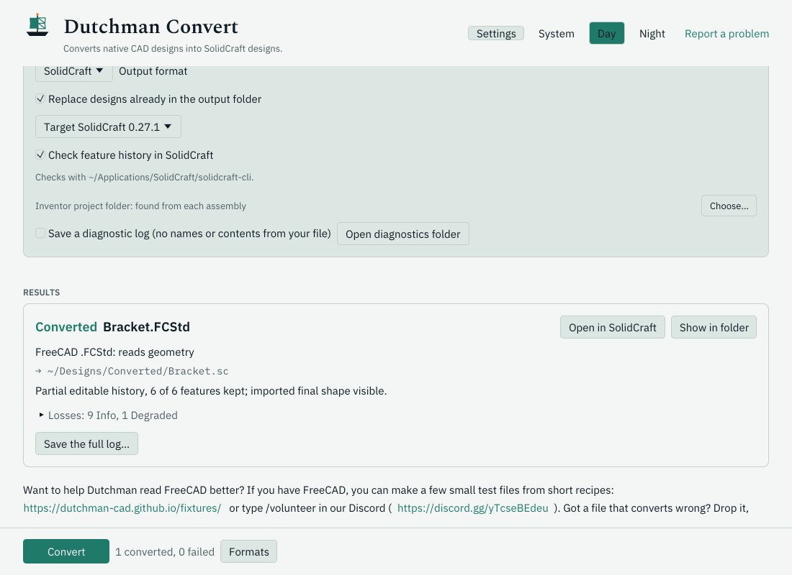

<h1>
  
  
</h1>

Converts Fusion, Inventor, SolidWorks parts, FreeCAD, CATIA, Rhino, Creo View, ACIS, and STEP designs into editable SolidCraft designs.

<a href="https://dutchman-cad.github.io/view.html?src=https://raw.githubusercontent.com/dutchman-cad/dutchman/main/docs/images/readme-result-day.png&alt=Dutchman%20Convert%20in%20Day%20theme%3A%20a%20CC0%20FreeCAD%20bracket%20converted%2C%20with%20its%20mapped%20feature%20history%20and%20Open%20in%20SolidCraft"></a>
<a href="https://dutchman-cad.github.io/view.html?src=https://raw.githubusercontent.com/dutchman-cad/dutchman/main/docs/images/readme-result-night.png&alt=Dutchman%20Convert%20in%20Night%20theme%3A%20the%20same%20CC0%20bracket%20conversion%20and%20its%20result%20card"></a>

## Download

- **Mac:** [download the app](https://github.com/dutchman-cad/dutchman/releases/latest/download/dutchman-macos-universal.dmg), or `brew install --cask dutchman-cad/tap/dutchman-convert`.
- **Windows:** [download the 64-bit ZIP](https://github.com/dutchman-cad/dutchman/releases/latest/download/dutchman-x86_64-pc-windows-msvc.zip), extract it, and open `dutchman-gui`; or `scoop bucket add dutchman-cad https://github.com/dutchman-cad/scoop-bucket` then `scoop install dutchman-cad/dutchman`.
- **Linux:** download for [x86_64](https://github.com/dutchman-cad/dutchman/releases/latest/download/dutchman-x86_64-unknown-linux-gnu.tar.gz) or [ARM64](https://github.com/dutchman-cad/dutchman/releases/latest/download/dutchman-aarch64-unknown-linux-gnu.tar.gz), extract it, and open `dutchman-gui`; or `brew install dutchman-cad/tap/dutchman`.

Every download holds the desktop app (`dutchman-gui`), the `dutchman` command, and the `dutchman-mcp` server. On macOS, the app needs a [one-time approval](docs/install.md#opening-the-app-the-first-time). [Install](docs/install.md) has Docker, nightly builds, and building from source.

<details>
<summary>All downloads, with checksums</summary>

<!-- downloads -->
| Your computer | Download | Checksum |
|---|---|---|
| Mac (any Mac): the desktop app | [dutchman-macos-universal.dmg](https://github.com/dutchman-cad/dutchman/releases/latest/download/dutchman-macos-universal.dmg) | [SHA-256](https://github.com/dutchman-cad/dutchman/releases/latest/download/dutchman-macos-universal.dmg.sha256) |
| Mac command line (any Mac) | [dutchman-macos-universal.tar.gz](https://github.com/dutchman-cad/dutchman/releases/latest/download/dutchman-macos-universal.tar.gz) | [SHA-256](https://github.com/dutchman-cad/dutchman/releases/latest/download/dutchman-macos-universal.tar.gz.sha256) |
| Windows, 64-bit | [dutchman-x86_64-pc-windows-msvc.zip](https://github.com/dutchman-cad/dutchman/releases/latest/download/dutchman-x86_64-pc-windows-msvc.zip) | [SHA-256](https://github.com/dutchman-cad/dutchman/releases/latest/download/dutchman-x86_64-pc-windows-msvc.zip.sha256) |
| Linux, x86_64 | [dutchman-x86_64-unknown-linux-gnu.tar.gz](https://github.com/dutchman-cad/dutchman/releases/latest/download/dutchman-x86_64-unknown-linux-gnu.tar.gz) | [SHA-256](https://github.com/dutchman-cad/dutchman/releases/latest/download/dutchman-x86_64-unknown-linux-gnu.tar.gz.sha256) |
| Linux, ARM 64-bit (aarch64) | [dutchman-aarch64-unknown-linux-gnu.tar.gz](https://github.com/dutchman-cad/dutchman/releases/latest/download/dutchman-aarch64-unknown-linux-gnu.tar.gz) | [SHA-256](https://github.com/dutchman-cad/dutchman/releases/latest/download/dutchman-aarch64-unknown-linux-gnu.tar.gz.sha256) |
<!-- /downloads -->

</details>

## How to use it

1. **Drop files or folders in.** Or choose **Add files…**, then choose an output folder.

   <a href="https://dutchman-cad.github.io/view.html?src=https://raw.githubusercontent.com/dutchman-cad/dutchman/main/docs/images/readme-drop-day.png&alt=Start%20screen%20with%20the%20drop%20area%20and%20Add%20files%20button"></a>

2. **Pick Fast, Standard, or Full.** Fast keeps the shape; Standard keeps history, sketches, and joints within the memory you have free; Full keeps everything that maps. The estimate shows memory and time before you start.

   <a href="https://dutchman-cad.github.io/view.html?src=https://raw.githubusercontent.com/dutchman-cad/dutchman/main/docs/images/readme-preset-day.png&alt=A%20CC0%20bracket%20queued%20with%20Standard%20selected%20and%20a%20live%20memory%20and%20time%20estimate"></a>

3. **Convert, then Open in SolidCraft.** The result card says what came across and what didn't. Your design is a `.sc` file.

   <a href="https://dutchman-cad.github.io/view.html?src=https://raw.githubusercontent.com/dutchman-cad/dutchman/main/docs/images/readme-result-day.png&alt=The%20CC0%20bracket%27s%20result%3A%20mapped%20feature%20history%20and%20Open%20in%20SolidCraft"></a>

## What's new in 0.2.5

- **Whole Fusion assemblies, part by part:** each component keeps its own features, sketches, and parameters, parts stay where the design puts them, and every body keeps its colour.
- **Much faster on big assemblies:** parts are prepared on several cores, with free memory deciding how many.
- **Choose what to keep, with an estimate first,** and an **anonymous diagnostic log** for any run.
- **Updates from the app,** and a pill naming the SolidCraft it found.

[Release notes](https://github.com/dutchman-cad/dutchman/releases/latest) · [Changelog](CHANGELOG.md)

## Command line

```sh
dutchman part.f3d                          # writes part.sc beside it
dutchman convert part.f3d out.sc --preset fast
dutchman inspect part.ipt                  # what would carry across, without writing
dutchman convert-all project/ --out-dir converted/
```

[Install the macOS command-line archive](docs/install.md#from-a-release-archive), including
checksum verification and adding the programs to your PATH.
[The command line](docs/command-line.md) covers every option.

## What converts

Early development: **Reads** says whether a format's geometry can be read, and each conversion's report says what that file kept. Run `dutchman formats` for the live list.

<!-- formats: generated from dutchman formats --markdown -->
| Format | Files | Reads | Level | Converts |
|---|---|---|---|---|
| Fusion archive | `.f3d` | Reads geometry | L5 | Geometry; feature history when every feature maps; components and mapped joints |
| Fusion multi-document archive | `.f3z` | Reads geometry | L5 | As a Fusion archive, with referenced designs merged in by cadmpeg |
| Inventor part | `.ipt` | Reads geometry | L3 | Geometry; feature history when every feature maps |
| Inventor assembly | `.iam` | Reads geometry | L3 | Placed parts and sub-assemblies, read from their files in the project |
| SolidWorks part | `.sldprt` | Reads geometry | L3 | Geometry; feature history waits on cadmpeg binding sketches and extrude profiles |
| SolidWorks assembly | `.sldasm` | Recognised, not read yet | – | Not yet |
| FreeCAD document | `.FCStd` | Reads geometry | L5 | Geometry and components; feature history and joints when they map |
| CATIA part | `.CATPart` | Reads geometry | L3 | Geometry through STEP; solids and surfaces SolidCraft can import |
| Creo part | `.prt`, `.prt.N` | Opens, no geometry yet | L1 | Not yet |
| NX part | `.prt` | Opens, no geometry yet | L1 | Not yet |
| Creo View | `.pvz` | Reads geometry | L3 | Geometry through STEP; solids and surfaces SolidCraft can import |
| Rhino | `.3dm` | Reads geometry | L2 | Geometry through STEP; solids and surfaces SolidCraft can import |
| ACIS | `.sat`, `.sab`, `.smt`, `.smb` | Reads geometry | L3 | Geometry through STEP; solids and surfaces SolidCraft can import |
| STEP | `.step`, `.stp` | Reads geometry | L8 | Geometry through STEP; solids and surfaces SolidCraft can import |
| IGES | `.igs`, `.iges` | Recognised, not converted | – | Import it in SolidCraft directly (File > Import) |
| Unidentified part (Creo or NX) | `.prt` | Recognised, not read yet | – | Not yet |

FreeCAD TechDraw drawings also convert to DXF (`--to dxf`): page curves, dimension labels, annotations, and templates, with unsupported content reported as Dropped.

Output is a SolidCraft design (`.sc`), or, experimental, a FreeCAD rebuild macro (`.FCMacro`, `--to freecad`).
<!-- /formats -->

[Formats](docs/formats.md) has the details for each program, and [Feature history](docs/history.md) what maps onto SolidCraft.

## Send us a file that won't convert

Make a small public test file from a [fixtures recipe](https://dutchman-cad.github.io/fixtures/),
or send a file that converts wrong, with its STEP export, to Dutchy in
[Discord](https://discord.gg/yTcseBEdeu). Share only designs you own and can share.

## Use from scripts and AI agents

`dutchman --json` prints one machine-readable report, and `dutchman-mcp` is a [Model Context Protocol](https://modelcontextprotocol.io) server on stdio with four tools, each returning the same report as the matching `--json` command:

| Tool | Arguments | Returns |
|---|---|---|
| `inspect` | `input` | `dutchman.inspect/1` |
| `convert` | `input`, `output`, and the convert options ([all arguments](docs/mcp.md#tools)) | `dutchman.convert/1` |
| `convert_all` | `inputs` (files and folders), `out_dir`, and optionally `jobs` and the convert options | `dutchman.convert-all/1` |
| `formats` | none | `dutchman.formats/1` |

For Claude Code:

```sh
claude mcp add dutchman -- dutchman-mcp
```

For other clients:

```json
{
  "mcpServers": {
    "dutchman": {
      "command": "dutchman-mcp"
    }
  }
}
```

[The MCP server](docs/mcp.md) has every argument, client setup, and safety; [JSON reports](docs/json.md) has every field. Exit codes: `0` converted, `1` could not convert, `2` usage error.

## Docs

**Using Dutchman**

- [Getting started](docs/guide.md): install, a first conversion, the loss report, and opening the result.
- [Install](docs/install.md): Homebrew, Scoop, release archives and checksums, Docker, nightly, and source.
- [The desktop app](docs/desktop.md): presets, estimates, the SolidCraft version pill, and updates.
- [The command line](docs/command-line.md): options, `inspect`, whole folders, and watching a folder.
- [Choosing what to keep](docs/presets.md): Fast, Standard, Full, and the memory and time estimate.
- [Troubleshooting](docs/troubleshooting.md): common problems and diagnostic logs.

**Formats and results**

- [Formats](docs/formats.md): how each format is recognised and what converts.
- [Fusion](docs/fusion.md), [Inventor](docs/inventor.md), [SolidWorks](docs/sldprt.md), and [FreeCAD](docs/freecad.md): what converts from each program today, and what stands in the way.
- [Feature history](docs/history.md): what maps onto SolidCraft, how it is checked, and partial history.
- [Testing Dutchman on your library](docs/testing-your-library.md): convert your own files and report what broke, without sharing a file.
- [The anonymous report](docs/report-anon.md): what is safe to share.

**Scripts, servers, and agents**

- [The MCP server](docs/mcp.md): every tool and argument, client setup, and safety.
- [JSON reports](docs/json.md): every field of the `--json` reports.
- [Docker](docs/docker.md): convert or run the MCP server in a container.
- [Dutchman Web](docs/web.md): convert in a browser, on a server you host.
- [Agent skill](skills/README.md): teaches an AI assistant to convert files with Dutchman.
- [Pilot](docs/pilot.md): drive SolidCraft from plain-language requests.
- [Dutchman Print](https://github.com/dutchman-cad/print): send designs to a 3D printer.

**Contributing**

- [CONTRIBUTING.md](CONTRIBUTING.md), and [AGENTS.md](AGENTS.md) for AI contributors.
- [Architecture](docs/ARCHITECTURE.md), [Releasing](docs/releasing.md), and [Triage](docs/triage.md).
- Report a file that didn't convert on the [**A file didn't convert**](https://github.com/dutchman-cad/dutchman/issues/new?template=file-did-not-convert.yml) form, with no design file. Questions: the [Discord](https://discord.gg/yTcseBEdeu).

## Licence

Dutchman is pure Rust, licensed under the [Apache License, Version 2.0](LICENSE). Native files are read by [cadmpeg](https://github.com/cadmpeg/cadmpeg); Dutchman maps them onto [SolidCraft](https://github.com/tangency-labs/solidcraft).
