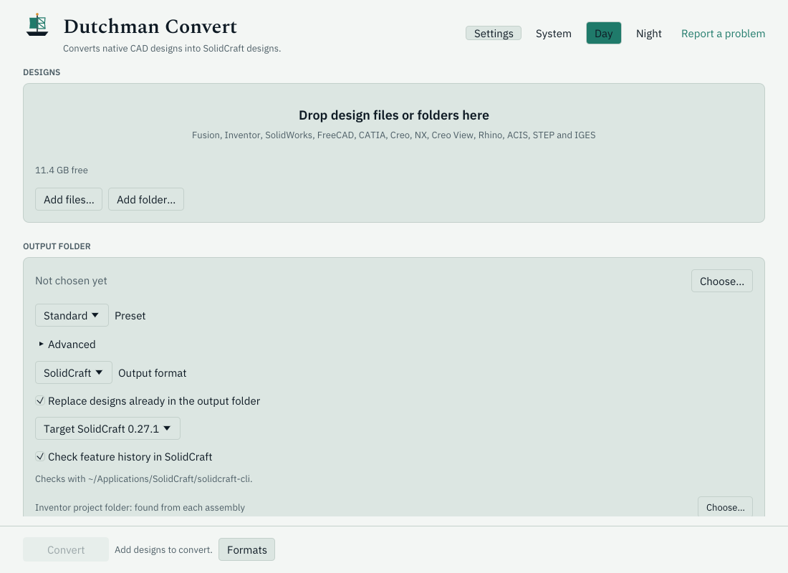
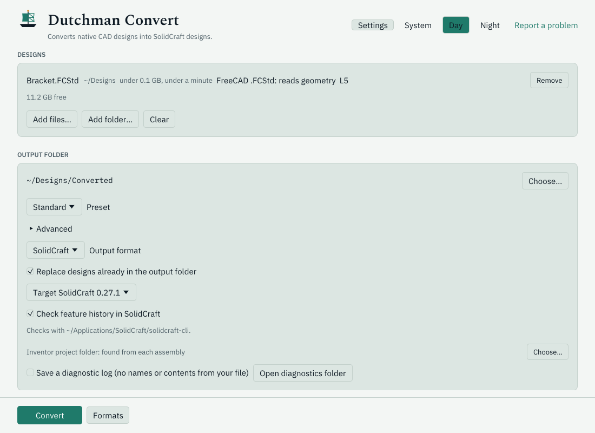
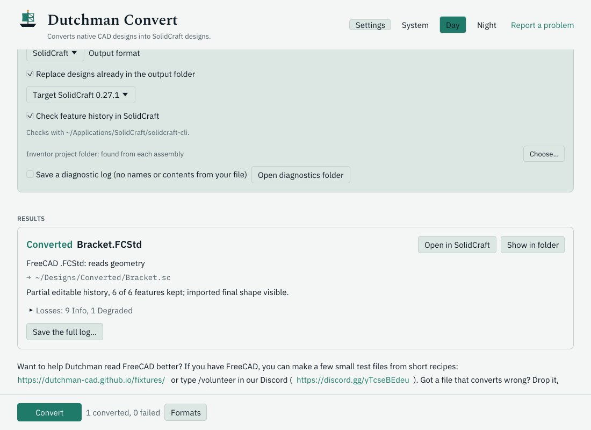
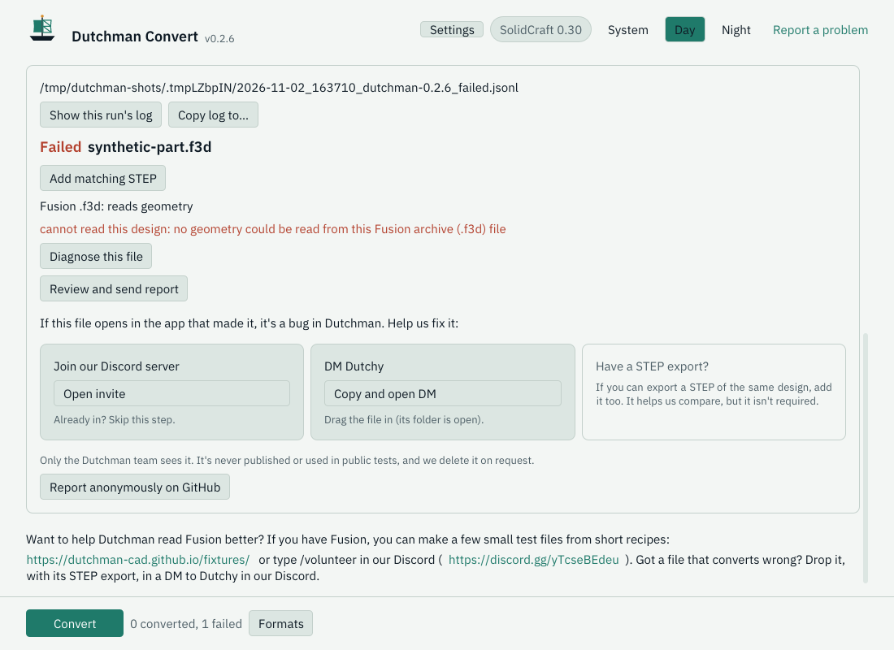

<h1>
  
  
</h1>

Converts Fusion, Inventor, SolidWorks, FreeCAD, CATIA, Creo, NX, Rhino, Creo View, ACIS, STEP, and offline Onshape bundles into SolidCraft designs, keeping editable features where they map.

<a href="https://dutchmancad.xyz/view.html?src=https://raw.githubusercontent.com/dutchman-cad/dutchman/main/docs/images/readme-result-day.png&alt=Dutchman%20Convert%20in%20Day%20theme%3A%20a%20CC0%20FreeCAD%20bracket%20converted%2C%20with%20its%20mapped%20feature%20history%20and%20Open%20in%20SolidCraft"></a>
<a href="https://dutchmancad.xyz/view.html?src=https://raw.githubusercontent.com/dutchman-cad/dutchman/main/docs/images/readme-result-night.png&alt=Dutchman%20Convert%20in%20Night%20theme%3A%20the%20same%20CC0%20bracket%20conversion%20and%20its%20result%20card"></a>

See it first: [converted designs in your browser](https://dutchmancad.xyz/demo/), including two complete 3D printers.

## Download

- **Mac:** [download the app](https://github.com/dutchman-cad/dutchman/releases/latest/download/dutchman-macos-universal.dmg), or `brew install --cask dutchman-cad/tap/dutchman-convert`.
- **Windows:** [download the 64-bit installer](https://github.com/dutchman-cad/dutchman/releases/latest/download/dutchman-x86_64-pc-windows-msvc.msi) and open **Dutchman Convert** from Start (no administrator rights needed). A [portable ZIP](https://github.com/dutchman-cad/dutchman/releases/latest/download/dutchman-x86_64-pc-windows-msvc.zip) is also available; or `scoop bucket add dutchman-cad https://github.com/dutchman-cad/scoop-bucket` then `scoop install dutchman-cad/dutchman`.
- **Linux:** download for [x86_64](https://github.com/dutchman-cad/dutchman/releases/latest/download/dutchman-x86_64-unknown-linux-gnu.tar.gz) or [ARM64](https://github.com/dutchman-cad/dutchman/releases/latest/download/dutchman-aarch64-unknown-linux-gnu.tar.gz), extract it, and open `dutchman-gui`; or `brew install dutchman-cad/tap/dutchman`.
- **Arch Linux** (0.2.10 and later): download `dutchman-bin-<version>-x86_64.pkg.tar.zst` from the [latest release](https://github.com/dutchman-cad/dutchman/releases/latest) and run `sudo pacman -U dutchman-bin-<version>-x86_64.pkg.tar.zst`. Once the package is on the AUR: `yay -S dutchman-bin`.
- **Linux AppImage** (0.2.10 and later): download `dutchman-<version>-x86_64.AppImage` (or `-aarch64`) from the [latest release](https://github.com/dutchman-cad/dutchman/releases/latest), run `chmod +x` on it, and run it. It works on any distribution and starts the desktop app. A launcher such as Gear Lever adds it to your menu and `PATH`; the command line programs are in it too ([how](docs/install.md#linux-the-appimage)).

The Windows installer is unsigned. If SmartScreen says **Windows protected your PC**, click
**More info**, then **Run anyway**. Windows 11's Smart App Control blocks it with no **Run anyway**
button; see [Smart App Control](docs/install.md#smart-app-control).

Release packages include local `skills/`, Markdown `docs/`, and an `AGENTS.md` explaining
commands and saved reports ([locations and omitted images](docs/install.md#included-guidance)).

Every download holds the desktop app (`dutchman-gui`), the `dutchman` command, and the `dutchman-mcp` server. On macOS, the app needs a [one-time approval](docs/install.md#opening-the-app-the-first-time). [Install](docs/install.md) has Docker, nightly builds, and building from source.

<details>
<summary>All downloads, with checksums</summary>

<!-- downloads -->
| Your computer | Download | Checksum |
|---|---|---|
| Mac (any Mac): the desktop app | [dutchman-macos-universal.dmg](https://github.com/dutchman-cad/dutchman/releases/latest/download/dutchman-macos-universal.dmg) | [SHA-256](https://github.com/dutchman-cad/dutchman/releases/latest/download/dutchman-macos-universal.dmg.sha256) |
| Mac command line (any Mac) | [dutchman-macos-universal.tar.gz](https://github.com/dutchman-cad/dutchman/releases/latest/download/dutchman-macos-universal.tar.gz) | [SHA-256](https://github.com/dutchman-cad/dutchman/releases/latest/download/dutchman-macos-universal.tar.gz.sha256) |
| Windows, 64-bit: installer | [dutchman-x86_64-pc-windows-msvc.msi](https://github.com/dutchman-cad/dutchman/releases/latest/download/dutchman-x86_64-pc-windows-msvc.msi) | [SHA-256](https://github.com/dutchman-cad/dutchman/releases/latest/download/dutchman-x86_64-pc-windows-msvc.msi.sha256) |
| Windows, 64-bit: portable ZIP | [dutchman-x86_64-pc-windows-msvc.zip](https://github.com/dutchman-cad/dutchman/releases/latest/download/dutchman-x86_64-pc-windows-msvc.zip) | [SHA-256](https://github.com/dutchman-cad/dutchman/releases/latest/download/dutchman-x86_64-pc-windows-msvc.zip.sha256) |
| Linux, x86_64 | [dutchman-x86_64-unknown-linux-gnu.tar.gz](https://github.com/dutchman-cad/dutchman/releases/latest/download/dutchman-x86_64-unknown-linux-gnu.tar.gz) | [SHA-256](https://github.com/dutchman-cad/dutchman/releases/latest/download/dutchman-x86_64-unknown-linux-gnu.tar.gz.sha256) |
| Linux, ARM 64-bit (aarch64) | [dutchman-aarch64-unknown-linux-gnu.tar.gz](https://github.com/dutchman-cad/dutchman/releases/latest/download/dutchman-aarch64-unknown-linux-gnu.tar.gz) | [SHA-256](https://github.com/dutchman-cad/dutchman/releases/latest/download/dutchman-aarch64-unknown-linux-gnu.tar.gz.sha256) |
<!-- /downloads -->

</details>

## How to use it

1. **Drop files or folders in.** Or choose **Add files…**, then choose an output folder.
   For a public Fusion or Google Drive file, paste its share link and choose **Add link**.
   Saved `.url` and `.webloc` shortcuts can be dropped too; see the [share link guide](docs/guide.md#public-share-links).

   <a href="https://dutchmancad.xyz/view.html?src=https://raw.githubusercontent.com/dutchman-cad/dutchman/main/docs/images/readme-drop-day.png&alt=Start%20screen%20with%20the%20drop%20area%20and%20Add%20files%20button"></a>

2. **Pick Fast, Standard, or Full.** Fast keeps the shape; Standard keeps history, sketches, and joints within the memory you have free; Full keeps everything that maps. The estimate shows memory and time before you start.

   <a href="https://dutchmancad.xyz/view.html?src=https://raw.githubusercontent.com/dutchman-cad/dutchman/main/docs/images/readme-preset-day.png&alt=A%20CC0%20bracket%20queued%20with%20Standard%20selected%20and%20a%20live%20memory%20and%20time%20estimate"></a>

3. **Convert, then Open in SolidCraft.** The result card says what came across and what didn't. Your design is a `.sc` file.

   <a href="https://dutchmancad.xyz/view.html?src=https://raw.githubusercontent.com/dutchman-cad/dutchman/main/docs/images/readme-result-day.png&alt=The%20CC0%20bracket%27s%20result%3A%20mapped%20feature%20history%20and%20Open%20in%20SolidCraft"></a>

## In FreeCAD

The [Dutchman add-on for FreeCAD](https://github.com/dutchman-cad/freecad-addon) opens Fusion, Inventor, SolidWorks and the other formats Dutchman reads straight in FreeCAD, with an import report panel that says what came across and what didn't. To install it, open **Tools > Addon Manager > Preferences**, add the custom repository `https://github.com/dutchman-cad/freecad-addon` (branch `main`), reopen the Addon Manager, install **freecad-addon** and restart FreeCAD. The first import offers to download Dutchman itself. See [the FreeCAD add-on](docs/freecad-addon.md).

## What's new in 0.3.0

- **Dutchman inside SolidCraft:** Install the Dutchman plugin with Preferences > Plugins > Install plugin… in SolidCraft 0.44 or newer (desktop) and approve its memory request (a plugin copied into the plugins folder by hand isn't approved and is refused for memory), then open Fusion, Inventor, SolidWorks and FreeCAD files directly, with editable history.
- **Onshape support:** Connect your Onshape account from the app or with `dutchman onshape login`, using your own API keys or an OAuth bearer token, then paste a Part Studio link or use `dutchman onshape fetch`.
- **SolidCraft 0.44 support:** SolidCraft 0.44 is the newest target.
- **More Fusion history stays editable:** Chamfers with two different distances, contour flanges, Split Body, Copy/Paste Bodies, mirrored-then-removed bodies, symmetric patterns, Base Features that later steps change, clockwise sketch arcs, narrow profile regions such as belt teeth, surface revolves of open curves, and sweep paths made of connected edges all keep their history.
- **Tell us when something is wrong:** "Is there a problem?
- **Batch reports, paste, share links and a look first:** After a folder run, Batch report writes `dutchman-batch-report.md` and `.csv` into the output folder: a totals line, then one row per file with its outcome (full history, partial N of M, geometry only, or failed) and the first reason.
- **More formats, options and fixes:** Siemens NX parts convert their geometry.

[Release notes](https://github.com/dutchman-cad/dutchman/releases/latest) · [Changelog](CHANGELOG.md)

## How Dutchman checks a history

When `solidcraft-cli` is available, Dutchman replays the written history in it and compares the
result with the original body, both measured by the same SolidCraft. The numbers are fixed:

- **Bodies:** the same count.
- **Volume:** within 0.01% (1e-4) of the larger volume, or the most SolidCraft's measuring mesh can miss, whichever is more.
- **Area:** within 0.1% (1e-3) of the larger area.
- **Position and bounding box:** the box center and each box corner within the larger of 0.01 mm and 0.02% (2e-4) of the larger box diagonal.
- **Face count and center of mass:** not compared. SolidCraft merges faces that share a surface, and the center used is the box center.
- **Edges, faces and extrude caps the source names:** an input edge must sit within 1e-6 mm of exactly one rebuilt edge; a profile face within 1e-5 mm, with area within 0.01% (2% when an edge is curved).

Every conversion report states the numbers its check used in `verification_tolerances`. The full
list is in [How a history is checked](docs/history.md#verification-tolerances).

## Command line

```sh
dutchman part.f3d                          # writes part.sc beside it
dutchman convert part.f3d out.sc --preset fast
dutchman inspect part.ipt                  # what would carry across, without writing
dutchman contents part.ipt                 # bodies, features, parameters and what maps
dutchman convert-all project/ --out-dir converted/
```

[Install the macOS command-line archive](docs/install.md#from-a-release-archive), including
checksum verification and adding the programs to your PATH.
[The command line](docs/command-line.md) covers every option.

## What converts

Fusion assemblies default to **Smart** part positions. Decoder-bound displayed poses take
precedence when available; otherwise current poses are accepted when
joints close, assembly bounds are respected, and repeated inserted designs move together.
Other parts keep their first placement. Choose **As last shown in the original program** to use all
available current poses, or **As first placed** to restore the old placement choice:
`--part-positions first-placed`, also available under **Advanced → Part positions** in the
desktop app. Joints work from the selected placements. Reports count the placement rules.

Early development: **Reads** says whether a format's geometry can be read, and each conversion's report says what that file kept. Run `dutchman formats` for the live list.

<!-- formats: generated from dutchman formats --markdown -->
| Format | Files | Reads | Level | Converts |
|---|---|---|---|---|
| Fusion archive | `.f3d` | Reads geometry | L5 | Geometry; feature history when every feature maps; components and mapped joints |
| Fusion multi-document archive | `.f3z` | Reads geometry | L5 | As a Fusion archive, with referenced designs merged in by cadmpeg |
| Inventor part | `.ipt` | Reads geometry | L3 | Geometry; feature history when every feature maps |
| Inventor assembly | `.iam` | Reads geometry | L3 | Placed parts and sub-assemblies, read from their files in the project |
| SolidWorks part | `.sldprt` | Reads geometry | L3 | Geometry; feature history waits on cadmpeg binding sketches and extrude profiles |
| SolidWorks assembly | `.sldasm` | Reads geometry | L3 | Placed parts and sub-assemblies, read from their files in the project |
| FreeCAD document | `.FCStd` | Reads geometry | L5 | Geometry and components; feature history and joints when they map |
| CATIA part | `.CATPart` | Reads geometry | L3 | Geometry through STEP; solids and surfaces SolidCraft can import |
| Creo part | `.prt`, `.prt.N` | Reads geometry | L1 | Geometry; solids and surfaces SolidCraft can import |
| NX part | `.prt` | Reads geometry | L1 | Geometry through STEP; solids and surfaces SolidCraft can import |
| Creo View | `.pvz` | Reads geometry | L3 | Geometry through STEP; solids and surfaces SolidCraft can import |
| Rhino | `.3dm` | Reads geometry | L2 | Geometry through STEP; solids and surfaces SolidCraft can import |
| ACIS | `.sat`, `.sab`, `.smt`, `.smb` | Reads geometry | L3 | Geometry through STEP; solids and surfaces SolidCraft can import |
| STEP | `.step`, `.stp` | Reads geometry | L8 | Geometry through STEP; solids and surfaces SolidCraft can import |
| Onshape bundle | `.onshape-bundle` | Reads geometry | – | One offline Part Studio; geometry and editable history where features map |
| IGES | `.igs`, `.iges` | Recognized, not converted | – | Import it in SolidCraft directly (File > Import) |
| Circuit board | `.PcbDoc` | Reads geometry with the electronics module | – | Placed parts and flat board layers, through the electronics module (`dutchman-electronics`, installed separately) |
| Unidentified part (Creo or NX) | `.prt` | Recognised, not read yet | – | Not yet |
| Inventor drawing | `.idw` | Recognized, but reading its sheets isn't supported yet. The report lists what was found. | – | A report of what was found; reading the sheets and views isn't supported yet, so no drawing is written |
| SolidWorks drawing | `.slddrw` | Recognized, but reading its sheets isn't supported yet. The report lists what was found. | – | A report of what was found; reading the sheets and views isn't supported yet, so no drawing is written |
| Fusion drawing | `.f2d` | Recognized, but reading its sheets isn't supported yet. The report lists what was found. | – | A report of what was found; reading the sheets and views isn't supported yet, so no drawing is written |
| DWG drawing | `.dwg` | Recognized, but reading its sheets isn't supported yet. The report lists what was found. | – | A report of what was found; reading the sheets and views isn't supported yet, so no drawing is written |
| DXF drawing | `.dxf` | Recognized, but reading its sheets isn't supported yet. The report lists what was found. | – | A report of what was found; reading the sheets and views isn't supported yet, so no drawing is written |
| Solid Edge drawing | `.dft` | Recognized, but reading its sheets isn't supported yet. The report lists what was found. | – | A report of what was found; reading the sheets and views isn't supported yet, so no drawing is written |

FreeCAD TechDraw pages are written into the converted SolidCraft design as a drawing (sheets and views), and also convert to DXF (`--to dxf`): page curves, dimension labels, annotations, and templates, with unsupported content reported as Dropped.

Fusion tool libraries (`.tools`, `.json`) also convert to CamCraft's `.camtools` (`dutchman library.tools`): tool geometry, holder and cutting data, with every tool and field CamCraft has no place for named in the report. See docs/camcraft-tools.md.

Output is a SolidCraft design (`.sc`), or, experimental, a FreeCAD rebuild macro (`.FCMacro`, `--to freecad`).
<!-- /formats -->

Designs open in SolidCraft 0.18.2 to 0.49; 0.49 is the newest known target.

A design Dutchman can't finish reading is stopped after 20 minutes with no progress (60 in all); in a Fusion `.f3z` archive it's left out and named, and the rest converts. Set `DUTCHMAN_DESIGN_TIME_LIMIT` to more minutes to give a large design longer.

[Formats](docs/formats.md) has the details for each program, and [Feature history](docs/history.md) what maps onto SolidCraft.

## Report a file that fails or converts wrong

Make a small public test file from a [fixtures recipe](https://dutchmancad.xyz/fixtures/),
or please send a file that converts wrong, with a STEP export of the exact same design, to Dutchy in
[Discord](https://discord.gg/yTcseBEdeu). Send only designs you have the right to send; we keep them private and use them only to fix the converter.

The desktop app always shows **Is there a problem? Is something missing?** at the bottom left:
join the Discord server, then DM Dutchy. The secondary buttons
**File a GitHub issue ↗** and, last, **Review and send report** sit directly below the three steps. The
anonymous report review shows
exactly which metadata will be sent; descriptions go in the private DM or GitHub form.
The CLI's `dutchman report` and MCP's `report_preview` / `report_submit` also support
converted-file summaries. See [Reporting a problem](docs/guide.md#report-consent).

With diagnostic logging enabled, each result card can **Show this run's log** or
**Copy log to…**. Its name includes the date, time, Dutchman version and result, with no
names or contents from the design. Report review and the copied Discord DM identify that
same log. [Reporting a problem](docs/desktop.md#reporting-a-problem) explains what is shared.



## Use from scripts and AI agents

For a desktop result with losses, **Ask your AI about this file** copies a short prompt
naming the saved report and the run's log; your assistant reads the bundled guidance from there
and uses the bundled command line for focused follow-up. No server setup is needed. See [desktop usage](docs/desktop.md#ask-your-ai-about-this-file).

`dutchman convert in.f3d out.sc --json` (or `dutchman --json convert …`) prints one machine-readable report, and `dutchman-mcp` is a [Model Context Protocol](https://modelcontextprotocol.io) server on stdio with conversion, diagnosis, and reporting tools. The core conversion tools return the same reports as their matching `--json` commands:

| Tool | Arguments | Returns |
|---|---|---|
| `inspect` | `input` | `dutchman.inspect/1` |
| `contents` | `input` | `dutchman.contents/1` |
| `convert` | `input`, `output`, and the convert options ([all arguments](docs/mcp.md#tools)) | `dutchman.convert/1` |
| `convert_all` | `inputs` (files and folders), `out_dir`, and optionally `jobs` and the convert options | `dutchman.convert-all/1` |
| `formats` | none | `dutchman.formats/1` |
| `read_report` | `input` (saved `.report.json` or its `.sc`; local paths stay private) | `dutchman.convert/1` plus `loss_groups` |

For Claude Code:

```sh
claude mcp add dutchman -- dutchman-mcp
```

For other clients:

```json
{
  "mcpServers": {
    "dutchman": {
      "command": "dutchman-mcp"
    }
  }
}
```

[The MCP server](docs/mcp.md) has every argument, client setup, and safety; [JSON reports](docs/json.md) has every field. Exit codes: `0` converted, `1` could not convert, `2` usage error.

## Docs

**Using Dutchman**

- [Getting started](docs/guide.md): install, a first conversion, the loss report, and opening the result.
- [Install](docs/install.md): Homebrew, Scoop, release archives and checksums, Docker, nightly, and source.
- [The FreeCAD add-on](docs/freecad-addon.md): open other CAD formats in FreeCAD through Dutchman.
- [The desktop app](docs/desktop.md): presets, estimates, the SolidCraft version pill, and updates.
- [The command line](docs/command-line.md): options, `inspect`, `contents`, whole folders, and watching a folder.
- [Choosing what to keep](docs/presets.md): Fast, Standard, Full, and the memory and time estimate.
- [Troubleshooting](docs/troubleshooting.md): common problems and diagnostic logs.
- [Find what breaks in a large private file](docs/diagnose.md): `dutchman diagnose` ranks the failing, slow and large parts by number, and `--part` converts one.
- [Make a minimum reproduction](docs/minimum-reproduction.md): isolate a failure locally and rebuild a small file you are free to share.

**Formats and results**

- [Formats](docs/formats.md): how each format is recognized and what converts.
- [Fusion tool libraries to CamCraft](docs/camcraft-tools.md): `.tools` and `.json` libraries to `.camtools`, field by field.
- [Fusion](docs/fusion.md), [Inventor](docs/inventor.md), [SolidWorks](docs/sldprt.md), and [FreeCAD](docs/freecad.md): what converts from each program today, and what stands in the way.
- [Feature history](docs/history.md): what maps onto SolidCraft, how it is checked, and partial history.
- [Testing Dutchman on your library](docs/testing-your-library.md): convert your own files and report what broke, without sharing a file.
- [The anonymous report](docs/report-anon.md): what is safe to share.

**Scripts, servers, and agents**

- [The MCP server](docs/mcp.md): every tool and argument, client setup, and safety.
- [JSON reports](docs/json.md): every field of the `--json` reports.
- [Docker](docs/docker.md): convert or run the MCP server in a container.
- [Dutchman Web](docs/web.md): convert in a browser, on a server you host.
- [Agent skill](skills/README.md): teaches an AI assistant to convert files with Dutchman.
- [Pilot](docs/pilot.md): drive SolidCraft from plain-language requests.
- [Dutchman Print](https://github.com/dutchman-cad/print): send designs to a 3D printer.

**Contributing**

- **Where to start:** [pick a CAD program](CONTRIBUTING.md#pick-a-cad-program) and paste its block
  into your AI agent: [SolidWorks](https://github.com/dutchman-cad/dutchman/issues/866),
  [Solid Edge](https://github.com/dutchman-cad/dutchman/issues/840), or any issue labeled
  [help wanted](https://github.com/dutchman-cad/dutchman/issues?q=is%3Aissue+is%3Aopen+label%3A%22help+wanted%22)
  or [good first issue](https://github.com/dutchman-cad/dutchman/issues?q=is%3Aissue+is%3Aopen+label%3A%22good+first+issue%22).
  Each one says what is known, what isn't, and how to verify it with public files.
- [CONTRIBUTING.md](CONTRIBUTING.md), and [AGENTS.md](AGENTS.md) for AI contributors.
- [Architecture](docs/ARCHITECTURE.md), [Releasing](docs/releasing.md), and [Triage](docs/triage.md).
- Report a file that didn't convert on the [**A file didn't convert**](https://github.com/dutchman-cad/dutchman/issues/new?template=file-did-not-convert.yml) form, with no design file. See [reporting versions and optional steps from report to fix](docs/testing-your-library.md#5-report-what-you-found). Questions: the [Discord](https://discord.gg/yTcseBEdeu).

## License

Dutchman is pure Rust, licensed under the [Apache License, Version 2.0](LICENSE). Native files are read by [cadmpeg](https://github.com/cadmpeg/cadmpeg); Dutchman maps them onto [SolidCraft](https://github.com/tangency-labs/solidcraft).

[Dutchman in SolidCraft](docs/solidcraft-plugin.md): a plugin that opens Fusion, Inventor, SolidWorks, and FreeCAD files in SolidCraft with editable history (SolidCraft 0.44 or newer, desktop only for now); [how it is built](docs/plugin.md).
