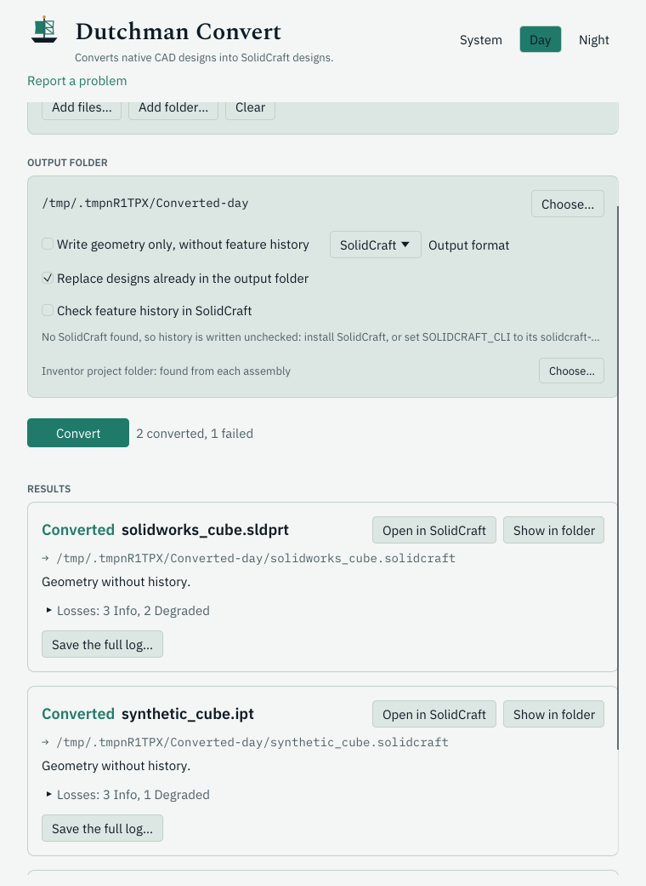

<h1>
  
  
</h1>

Dutchman ferries CAD designs between formats: it converts native CAD designs into open,
editable models. Reading the native file is
done by [cadmpeg](https://github.com/cadmpeg/cadmpeg); Dutchman maps cadmpeg's model onto a
target format, starting with [SolidCraft](https://github.com/tangency-labs/solidcraft) designs.

```sh
dutchman convert part.f3d part.solidcraft
```

## Download

<!-- downloads -->
| Your computer | Download | Checksum |
|---|---|---|
| Mac with Apple silicon (M1 or later) | [dutchman-0.1.2-aarch64-apple-darwin.tar.gz](https://github.com/dutchman-cad/dutchman/releases/download/v0.1.2/dutchman-0.1.2-aarch64-apple-darwin.tar.gz) | [SHA-256](https://github.com/dutchman-cad/dutchman/releases/download/v0.1.2/dutchman-0.1.2-aarch64-apple-darwin.tar.gz.sha256) |
| Mac with an Intel processor | [dutchman-0.1.2-x86_64-apple-darwin.tar.gz](https://github.com/dutchman-cad/dutchman/releases/download/v0.1.2/dutchman-0.1.2-x86_64-apple-darwin.tar.gz) | [SHA-256](https://github.com/dutchman-cad/dutchman/releases/download/v0.1.2/dutchman-0.1.2-x86_64-apple-darwin.tar.gz.sha256) |
| Windows, 64-bit | [dutchman-0.1.2-x86_64-pc-windows-msvc.zip](https://github.com/dutchman-cad/dutchman/releases/download/v0.1.2/dutchman-0.1.2-x86_64-pc-windows-msvc.zip) | [SHA-256](https://github.com/dutchman-cad/dutchman/releases/download/v0.1.2/dutchman-0.1.2-x86_64-pc-windows-msvc.zip.sha256) |
| Linux, x86_64 | [dutchman-0.1.2-x86_64-unknown-linux-gnu.tar.gz](https://github.com/dutchman-cad/dutchman/releases/download/v0.1.2/dutchman-0.1.2-x86_64-unknown-linux-gnu.tar.gz) | [SHA-256](https://github.com/dutchman-cad/dutchman/releases/download/v0.1.2/dutchman-0.1.2-x86_64-unknown-linux-gnu.tar.gz.sha256) |
| Linux, ARM 64-bit (aarch64) | [dutchman-0.1.2-aarch64-unknown-linux-gnu.tar.gz](https://github.com/dutchman-cad/dutchman/releases/download/v0.1.2/dutchman-0.1.2-aarch64-unknown-linux-gnu.tar.gz) | [SHA-256](https://github.com/dutchman-cad/dutchman/releases/download/v0.1.2/dutchman-0.1.2-aarch64-unknown-linux-gnu.tar.gz.sha256) |

Not sure which Mac you have? Apple menu › **About This Mac**: a chip named Apple M… is Apple silicon; a processor named Intel… is Intel.
<!-- /downloads -->

Each archive holds `dutchman`, `dutchman-mcp` and the desktop app, `dutchman-gui`.
[Getting started](docs/guide.md) shows how to check it, install it and convert a sample in a
minute. Every release is on the [releases page](https://github.com/dutchman-cad/dutchman/releases).

## What converts

Early development. Fusion (`.f3d`, `.f3z`) designs, Inventor parts (`.ipt`), Inventor
assemblies (`.iam`, with their parts found anywhere in the project), SolidWorks parts
(`.sldprt`) and FreeCAD documents (`.FCStd`) convert today:

- When every feature in a design's history maps onto SolidCraft (sketches and extrudes so
  far), the SolidCraft design keeps that history, editable, with the original geometry kept
  beside it. If `solidcraft-cli` is installed, Dutchman replays the history in it and checks
  it against the original before keeping it.
- Otherwise the design converts as solid geometry without history.
- Every conversion lists what it could not carry across, as Info, Degraded or Dropped.

`dutchman formats` lists what converts from each format; `dutchman convert --help` lists the
options.

See [docs/ARCHITECTURE.md](docs/ARCHITECTURE.md) for how it fits together.

## Desktop app

`dutchman-gui` converts without a terminal. Drop design files or folders on the window (or use
**Add files…** and **Add folder…**), choose an output folder, and press **Convert**. Each file
shows whether it converted, what was written (editable history or geometry), and its losses as
Info, Degraded or Dropped. A converted design opens in SolidCraft from its card: the app that
`SOLIDCRAFT_APP` names, else `solidcraft` on `PATH`, else the system's app for `.solidcraft`
files. When an Inventor assembly's part files are not found, its card names them: **Search a
folder…** or **Find a file…** converts it again, searching there too. The app follows the
system's light or dark setting, or can be set to Day or Night.

<picture>
  <source media="(prefers-color-scheme: dark)" srcset="docs/images/dutchman-gui-night.png">
  
</picture>

It ships in the release archives beside `dutchman` (from 0.1.1 on), or build it from source
with Rust 1.88 or newer:

```sh
cargo install --git https://github.com/dutchman-cad/dutchman dutchman-gui
```

On Linux it needs a desktop session (X11 or Wayland with OpenGL); the file dialogs use the
desktop portal, and dropping files works without it.

## Docs

- [Getting started](docs/guide.md): install, convert, read the loss report, open the result
  in SolidCraft, troubleshooting.
- [The MCP server](docs/mcp.md): tools, client setup for Claude Code, Codex and others,
  example calls, safety.
- [Agent skill](skills/README.md): teaches an AI assistant to convert files with Dutchman and
  explain the results.
- [JSON reports](docs/json.md): every field of the `--json` reports, and
  [the anonymous batch report](docs/report-anon.md) that is safe to share.
- [Testing Dutchman on your library](docs/testing-your-library.md): convert your own files
  and report what broke, without sharing a file.
- Formats: [Fusion](docs/fusion.md), [Inventor](docs/inventor.md),
  [SolidWorks](docs/sldprt.md), [FreeCAD](docs/freecad.md).
- Contributing: [CONTRIBUTING.md](CONTRIBUTING.md), and [AGENTS.md](AGENTS.md) for AI
  contributors.

## Use from scripts and AI agents

Download a prebuilt archive from the
[latest release](https://github.com/dutchman-cad/dutchman/releases/latest) (see
[Getting started](docs/guide.md#install)), or install from source (Rust 1.88 or newer):

```sh
cargo install --git https://github.com/dutchman-cad/dutchman dutchman
```

See what would carry across, without writing anything:

```sh
dutchman inspect --json part.ipt
```

Convert, with one JSON report on stdout:

```sh
dutchman convert --json part.f3d part.solidcraft
```

Convert a whole project folder, four files at a time:

```sh
dutchman convert-all --json --jobs 4 --out-dir converted/ project/
```

Exit codes: `0` converted, `1` could not convert (the JSON report has `"ok": false` and
`error.message`), `2` usage error. A written history is checked in SolidCraft when
`solidcraft-cli` is found: set `SOLIDCRAFT_CLI` to its path, or pass `--solidcraft PATH`.
[docs/json.md](docs/json.md) describes every field; field names are stable.

### As an MCP server

`cargo install` also installs `dutchman-mcp`, a [Model Context Protocol](https://modelcontextprotocol.io)
server on stdio. It gives an agent four tools, each returning the same report as the matching
`--json` command:

| Tool | Arguments | Returns |
|---|---|---|
| `inspect` | `input` | `dutchman.inspect/1` |
| `convert` | `input`, `output`, and optionally `import_only`, `verify`, `solidcraft`, `verify_timeout`, `overwrite` | `dutchman.convert/1` |
| `convert_all` | `inputs` (files and folders), `out_dir`, and optionally `jobs` and the convert options | `dutchman.convert-all/1` |
| `formats` | none | `dutchman.formats/1` |

A conversion that fails comes back as a tool error carrying its failure report. Paths are on
the machine running the server, so give absolute ones. `convert` writes only its `output`
file, and `convert_all` writes only inside `out_dir`.

For Claude Code:

```sh
claude mcp add dutchman -- dutchman-mcp
```

For other clients, the usual configuration entry is:

```json
{
  "mcpServers": {
    "dutchman": {
      "command": "dutchman-mcp",
      "env": {"SOLIDCRAFT_CLI": "/path/to/solidcraft-cli"}
    }
  }
}
```

`SOLIDCRAFT_CLI` is optional: without it, a written history is checked only when
`solidcraft-cli` is on the server's `PATH`, and is reported unverified otherwise.

## Building

```sh
cargo build --release
cargo test --workspace
```

## Licence

Licensed under the [Apache License, Version 2.0](LICENSE).
