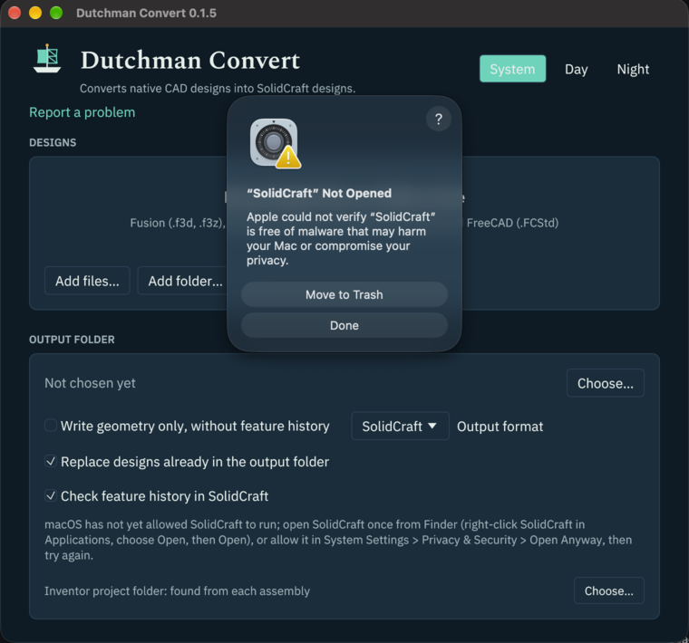

# Getting started

Dutchman Convert is the `dutchman` command. Its main job is converting native CAD files into [SolidCraft](https://github.com/tangency-labs/solidcraft)
designs (`.solidcraft`). This guide covers installing it, converting your first design,
reading what the conversion reports, and opening the result in SolidCraft.

```sh
dutchman part.f3d                 # writes part.solidcraft
dutchman part.f3d out.solidcraft
dutchman convert part.f3d out.solidcraft
```

Omit the output to write beside the input, using its stem and the extension chosen by
`--to`: `.solidcraft` (default), `.FCMacro`, or `.FCStd`. If that default exists, Dutchman
exits 2 without changing it: choose `-o PATH` or pass `--force` to replace it. A default
that is the input itself is always refused. `--force` conflicts with `--no-clobber`.
Explicit output paths are replaced unless `--no-clobber` is given. Built-in commands win
over files with the same name; use `dutchman convert pilot` for a file named `pilot`.
Installed tools take precedence over bare files; otherwise an existing file or a recognised
CAD extension selects conversion.

- [Install](#install)
- [Your first conversion](#your-first-conversion)
- [Look before you convert: inspect](#look-before-you-convert-inspect)
- [Convert a whole folder: convert-all](#convert-a-whole-folder-convert-all)
- [Watch a folder](#watch-a-folder)
- [Formats](#formats)
- [Pilot](#pilot)
- [Reading the loss report](#reading-the-loss-report)
- [Feature history and the SolidCraft check](#feature-history-and-the-solidcraft-check)
- [Open the result in SolidCraft](#open-the-result-in-solidcraft)
- [Troubleshooting](#troubleshooting)

`dutchman pilot` and `dutchman fixtures` also run other installed Dutchman CAD tools.
Install `dutchman-pilot` or `dutchman-fixtures` next to `dutchman` or on `PATH`; the copy
next to `dutchman` wins. `dutchman --help` (or `dutchman` alone) lists installed tools with
their versions. An installed Pilot receives its arguments unchanged, taking precedence over
the built-in Pilot. Without it, builds with the default `pilot` feature use the built-in
Pilot; other missing tools print their installation link and exit 1.

`dutchman printers` and `dutchman print FILE --printer ID` run [Dutchman Print](https://github.com/dutchman-cad/print),
`dutchman-print`, when it is installed.

Pilot-only installations can ship the small `dutchman-launcher` binary renamed to `dutchman`.
It runs installed tools and identifies itself as `dutchman launcher <version>` with
`--version`. Get [Dutchman Convert](https://github.com/dutchman-cad/dutchman) for `convert`,
`convert-all`, `watch`, `inspect` and `formats`.

## Install

### Homebrew or Scoop

On macOS or Linux with [Homebrew](https://brew.sh):

```sh
brew install dutchman-cad/tap/dutchman
```

On Windows with [Scoop](https://scoop.sh):

```powershell
scoop bucket add dutchman-cad https://github.com/dutchman-cad/scoop-bucket
scoop install dutchman-cad/dutchman
```

Either installs `dutchman`, `dutchman-mcp` and the desktop app, `dutchman-gui` (Scoop also adds
a **Dutchman Convert** Start menu shortcut), on your `PATH`. `brew upgrade` or `scoop update`
brings each new release, usually within an hour of it. Homebrew pours a ready-made bottle, so
it needs no Xcode or Command Line Tools. On macOS the commands Homebrew installs open without
the first-run approval below, because Homebrew's downloads are not quarantined.

On macOS, Homebrew also installs the app, **Dutchman Convert.app**, in Applications and
Launchpad:

```sh
brew install --cask dutchman-cad/tap/dutchman-convert
```

Homebrew quarantines the apps it installs, so the app needs the
[first-run approval](#opening-the-app-the-first-time) once, as from the disk image.
[Pilot](https://github.com/dutchman-cad/pilot) installs the same way, as `dutchman-pilot`
(`brew install dutchman-cad/tap/dutchman-pilot`, `scoop install dutchman-cad/dutchman-pilot`).

### macOS: the app

From 0.1.3 on, each release has `dutchman-VERSION-macos-universal.dmg`: **Dutchman
Convert.app** (named **Dutchman.app** in 0.1.5 and earlier), for Apple silicon and Intel Macs
alike, with the `dutchman` and `dutchman-mcp` commands inside it.

1. Open the disk image and drag **Dutchman Convert** onto **Applications**.
2. Open it from Applications or Launchpad, where it is shown as **Dutchman** (the file is
   `Dutchman Convert.app`).

#### Opening the app the first time

Dutchman Convert is not signed with an Apple Developer ID, so the first time you open it macOS
stops it with this box:


Click **Done**, not Move to Trash, then:

1. Open **System Settings** › **Privacy & Security**.
2. Scroll down to **Security**. It says “Dutchman” was blocked to protect your Mac.
3. Click **Open Anyway**, enter your password, then click **Open Anyway** in the box that
   follows.


macOS remembers the choice; from then on Dutchman Convert opens like any other app. Right-click ›
Open, which older macOS versions offered, no longer gets past the box.

Or clear the download's quarantine flag once, in Terminal:

```sh
xattr -dr com.apple.quarantine "/Applications/Dutchman Convert.app"
```

The app is signed ad hoc, so macOS never calls it “damaged”. If it does, the download was
cut short or changed: download it again and check it against its `.sha256`
(`shasum -a 256 -c dutchman-VERSION-macos-universal.dmg.sha256`).

The commands inside the app (`dutchman`, `dutchman-mcp`) are covered by the same approval.
Run before it, from Terminal, they meet the same box: approve the app once, as above, and they
run too.

To use the commands from Terminal, link them onto your `PATH`:

```sh
sudo ln -sf "/Applications/Dutchman Convert.app/Contents/Helpers/dutchman" /usr/local/bin/dutchman
sudo ln -sf "/Applications/Dutchman Convert.app/Contents/Helpers/dutchman-mcp" /usr/local/bin/dutchman-mcp
```

With 0.1.5 or earlier, write `/Applications/Dutchman.app` in these commands instead.

### From a release archive

Each [release](https://github.com/dutchman-cad/dutchman/releases) has archives for the
platforms below. Each archive holds `dutchman` (the command), `dutchman-mcp` (the
[MCP server](mcp.md)), `dutchman-gui` (the desktop app, from 0.1.1 on), `LICENSE`, `NOTICE`,
`README.md` and the font licences, with a `.sha256` file beside it.

| Platform | Archive |
|---|---|
| Linux, x86_64 | `dutchman-VERSION-x86_64-unknown-linux-gnu.tar.gz` |
| Linux, ARM64 | `dutchman-VERSION-aarch64-unknown-linux-gnu.tar.gz` |
| macOS, Apple silicon or Intel | `dutchman-VERSION-macos-universal.tar.gz` |
| macOS, Apple silicon (per-chip archive) | `dutchman-VERSION-aarch64-apple-darwin.tar.gz` |
| macOS, Intel (per-chip archive) | `dutchman-VERSION-x86_64-apple-darwin.tar.gz` |
| Windows, x86_64 | `dutchman-VERSION-x86_64-pc-windows-msvc.zip` |

The universal macOS archive runs on both Apple silicon and Intel. Per-chip archives remain
available for Homebrew and other installations that select a processor.

Download the archive and its `.sha256` file, check one against the other, then unpack it and
put the programs on your `PATH`. On Linux x86_64, for release 0.1.5 (set `VERSION` and the
target for another release or machine):

```sh
VERSION=0.1.5 TARGET=x86_64-unknown-linux-gnu
base=https://github.com/dutchman-cad/dutchman/releases/download/v$VERSION
curl -fLO "$base/dutchman-$VERSION-$TARGET.tar.gz"
curl -fLO "$base/dutchman-$VERSION-$TARGET.tar.gz.sha256"
sha256sum -c dutchman-$VERSION-$TARGET.tar.gz.sha256
tar xzf dutchman-$VERSION-$TARGET.tar.gz
mkdir -p "$HOME/.local/bin"
install -m 755 dutchman-$VERSION-$TARGET/dutchman* "$HOME/.local/bin/"
export PATH="$HOME/.local/bin:$PATH"
dutchman --version
```

The `export` lasts for this shell; add the same line to your shell's profile (`~/.bashrc`,
`~/.zshrc`) to keep it. The `dutchman*` pattern installs the desktop app, `dutchman-gui`, too.

On Linux, launch the desktop app with `dutchman-gui` from a terminal. It needs an X11 or
Wayland desktop session with working OpenGL. See [Troubleshooting](#troubleshooting) if no
window appears.

The target SolidCraft selector defaults to the found CLI's version, else 0.18.2, even
when history checking is off. Choose **0.18.2 and newer** for older installations or
**0.25.1 and newer** to keep supported FreeCAD helices as editable coils.

The window's title shows its version, and its **Report a problem** link opens the
[A file didn't convert](https://github.com/dutchman-cad/dutchman/issues/new?template=file-did-not-convert.yml)
form. `dutchman-gui --version` and `dutchman-gui --help` print and exit without opening a
window (on Windows, read the version with `dutchman --version`).

When a file fails, its card says so and offers **Report this on GitHub**. It opens the same
form in your browser, filled in: Dutchman's version, your system, the error with its stage
and upstream, and the file's anonymous report, which names no file and no folder. Read it
before you submit, and never attach the design; a link to a file that is already public is
welcome. The link stays short enough for GitHub to open it while you are signed in: if the
anonymous report does not fit, the app copies it for you to paste into the form's
**Anonymous report for this file** box, and a very long error message is shortened in the
form (the anonymous report has all of it).

On macOS, `shasum -a 256 -c` takes the place of `sha256sum -c`. The programs are not signed
with a Developer ID, so macOS blocks each the first time, as it does
[the app](#opening-the-app-the-first-time); allow it in System Settings › Privacy & Security,
or clear the quarantine flag:

```sh
xattr -d com.apple.quarantine dutchman dutchman-mcp dutchman-gui
```

On Windows, in PowerShell, compare the hash with the one in the `.sha256` file, then unpack
the archive and add its folder to your `PATH`:

```powershell
Get-FileHash dutchman-VERSION-x86_64-pc-windows-msvc.zip -Algorithm SHA256
Get-Content dutchman-VERSION-x86_64-pc-windows-msvc.zip.sha256
Expand-Archive dutchman-VERSION-x86_64-pc-windows-msvc.zip -DestinationPath .
```

### Channels: stable and nightly

- **Stable** releases (`v0.1.5`, …) are the ones to use. Each is built against one tested
  commit of cadmpeg, the library that reads the native files.
- **Nightly** is one pre-release, [`nightly`](https://github.com/dutchman-cad/dutchman/releases/tag/nightly),
  rebuilt each day from Dutchman's latest code against cadmpeg's latest code, and published
  only when every test passes. Its notes give both commits and the date. Its archives are
  named `dutchman-nightly-TARGET` and install the same way. Use it when an issue says a fix is
  merged but not in a release yet; go back to stable once a stable release has it.

### From source

With Rust 1.88 or newer:

```sh
cargo install --git https://github.com/dutchman-cad/dutchman dutchman
```

This installs both `dutchman` and `dutchman-mcp`. Check the install:

```sh
dutchman --version
```

### Docker

Each release is published as a container image with `dutchman`, `dutchman-mcp` and
`dutchman-web`, without the desktop app, for amd64 and arm64:
`docker pull ghcr.io/dutchman-cad/dutchman:latest`. The repository's `Dockerfile` builds the
same from source. [Docker](docker.md) says how to get it and convert with it.

### Dutchman Web, in a browser

`dutchman-web` serves a page that converts uploaded designs, for a Dutchman hosted on one
server and used from any browser. [Dutchman Web](web.md) says how to run it.

### SolidCraft (optional, recommended)

A part that holds an imported solid becomes a base-body Import feature at its place in the
timeline. Later features keep editable history when they map. Stored geometry has no recipe
to lose: the report says, at Info level, “This part holds an imported solid; there is no
feature history to bring over”. A part made only of stored geometry is geometry without
history, with no flattened-history warning.

When a design's feature history converts, Dutchman checks it by replaying it in SolidCraft's
command-line tool, `solidcraft-cli`, which comes with every
[SolidCraft release](https://github.com/tangency-labs/solidcraft/releases). Installing the
SolidCraft app is enough: Dutchman finds the tool inside it (on macOS, the newest
`SolidCraft*.app` in `/Applications` or `~/Applications`; on Windows, `Program Files\SolidCraft`).
`--solidcraft PATH`, `SOLIDCRAFT_CLI`, or `solidcraft-cli` on your `PATH` come first. The
desktop app says which one it checks with. Without one, conversions still work; a converted
history is marked unverified.

On macOS, let SolidCraft itself run once before the first check: open SolidCraft from
Applications, click **Done** when macOS stops it, then click **Open Anyway** in **System
Settings > Privacy & Security**, the same steps as for Dutchman Convert. Dutchman reads the
app's quarantine attribute and its user-approved flag without changing them. The desktop app
retries a blocked check when its window regains focus or you start a conversion. Until then
it says so under the check option:



Dutchman's default compatibility floor is **SolidCraft 0.18.2**, and conversions are tested
with 0.18.2, 0.19.0, 0.20.0, and 0.25.1. Each design targets the verification CLI's version
when found, else 0.18.2. Use `--solidcraft-version x.y.z` to choose a target on `convert`,
`convert-all`, or `watch`; versions below 0.18.2 and malformed versions are refused.
With `--no-verify` and no explicit target, the target is 0.18.2. Features that need a newer
release block history and preserve the original geometry as for other blockers.
A design opens in its target release and newer releases. A `solidcraft-cli` older than
0.18.2 is not used: the conversion says so ("… is older
than SolidCraft 0.18.2, the oldest that opens and checks Dutchman's designs; install a newer
SolidCraft") and writes the history unverified. SolidCraft 0.19.0 saves designs in a newer
format that older versions do not open, so a design you save again in 0.19.0 opens in 0.19.0
or newer only.

Sheet-metal history includes base flanges (not of symmetric thickness) and full-edge flanges
on an unchanged rectangular base sheet. An edge flange needs its own CADIR input topology
with edge midpoint, tangent, and end vertices; each midpoint must identify exactly one edge
of the rebuilt base sheet. Fixed outer-face heights, angles between zero and 180 degrees,
inside/outside bend placement, and positive bend radii map. Inner-face heights, partial widths,
object-ended heights, adjacent/tangent bend placement, and picks on already modified sheets
keep the geometry and report the reason. Final-body edges alone never select a flange.
Hems keep geometry: CADIR specifies developed length while SolidCraft requires length to the
outer face, and rolled, teardrop, and unresolved hem forms are not supported yet. CADIR has no
contour-flange, bend, unfold/refold, or corner-relief operations, nor K-factor or relief
settings; sheet rules keep SolidCraft's defaults for those settings. The report names the
first feature that stops the history; the original geometry is still converted.

## Your first conversion

You need a native CAD file. Dutchman has no public sample designs yet, but its tests use
small synthetic files that are fine to try: they are in
[`crates/dutchman-core/tests/fixtures/`](../crates/dutchman-core/tests/fixtures/), with
where each came from in that folder's README. None is a real design. `solidworks_cube.sldprt`
is a 10 mm cube; `generated_unit_cube.f3d` and `synthetic_cube.ipt` are the same cube as
Fusion and Inventor files. To download them:

```sh
fixtures=https://raw.githubusercontent.com/dutchman-cad/dutchman/main/crates/dutchman-core/tests/fixtures
curl -fLO "$fixtures/solidworks_cube.sldprt"
curl -fLO "$fixtures/generated_unit_cube.f3d"
curl -fLO "$fixtures/synthetic_cube.ipt"
```

```sh
dutchman convert solidworks_cube.sldprt cube.solidcraft
```

```text
SolidWorks .sldprt: reads geometry
converted  solidworks_cube.sldprt -> cube.solidcraft (geometry without history)
dutchman: Degraded: sldprt/source.dialect-unverified: the document carries no swSolidWorks swVersion declaration, so no declared identity was verified. …
dutchman: Degraded: sldprt/config.inferred-without-native: 1 configuration state(s) are inferred from geometry partitions without native configuration definitions.
dutchman: Info: step/design.parametric-records-omitted: 1 parametric/design record(s) were not represented in STEP: configuration=1
dutchman: Info: step/native.passthrough-record-omitted: 2 uninterpreted passthrough record(s) were not represented in STEP
dutchman: Info: step/native.source-record-omitted: 1 source-native record(s) were not represented in STEP
dutchman: Info: history: flattened: the design carries no feature history
dutchman: (notes are cut to their first sentence; --verbose prints them in full)
Want to help Dutchman read SolidWorks better? If you have SolidWorks, you can make a few small test files from short recipes: https://dutchman-cad.github.io/fixtures/ or type /volunteer in our Discord (https://discord.gg/yTcseBEdeu).
```

The synthetic SolidWorks cube lacks native version and configuration metadata, so those
warnings are expected for this sample. The internal records omitted from STEP do not change
its shape: the written geometry should be one 10 mm cube (1,000 mm³). The sample has no
editable feature history. Check the result in SolidCraft as [below](#open-the-result-in-solidcraft).

The exit code is 0, and the first line, on stdout, says what was written where: here the
geometry, as this file has no feature history (else `editable history, verified in SolidCraft`
or `editable history, unverified`). After progress updates, the lines on stderr are the loss report, explained
[below](#reading-the-loss-report). Long notes are cut to their first sentence, marked `…`;
`--verbose` prints them whole. An explicitly named existing output file is
replaced (`--no-clobber` keeps it, and the conversion fails instead), and nothing is written
when the conversion fails.

The output must end in `.solidcraft`. To get one machine-readable report on stdout instead
of the text, add `--json` ([json.md](json.md) describes every field):

```sh
dutchman convert --json generated_unit_cube.f3d cube.solidcraft
```

```json
{"history":{"features":[],"mapped":0,"total":0},
 "input":{"format":"fusion_archive","format_name":"Fusion archive (.f3d)","path":"generated_unit_cube.f3d"},
 "losses":[
  {"code":"f3d/material.not-transferred","level":"Degraded","message":"Materials/appearances (.protein assets, ACT/design assignments) were not transferred.","subject":"f3d/material.not-transferred"},
  {"code":"step/attribute.source-record-not-written","level":"Info","message":"7 source attribute record(s) were not written to STEP","subject":"step/attribute.source-record-not-written"},
  {"code":"step/native.source-record-omitted","level":"Info","message":"45 source-native record(s) were not represented in STEP","subject":"step/native.source-record-omitted"},
  {"code":null,"level":"Info","message":"flattened: the design carries no feature history","subject":"history"}],
 "mode":"import","ok":true,
 "output":{"format":"solidcraft/23","path":"cube.solidcraft"},
 "schema":"dutchman.convert/1",
 "verification":{"reason":"the design carries no feature history","status":"not_applicable"}}
```

(Printed on one line; wrapped here.)

### Options

| Option | What it does |
|---|---|
| `--import-only` | Write the geometry as one non-parametric import, never the feature history. |
| `--solidcraft PATH` | The `solidcraft-cli` that checks a converted history. Default: `$SOLIDCRAFT_CLI`, else `solidcraft-cli` on `PATH`, else the one inside an installed SolidCraft app (macOS `SolidCraft*.app`, newest first; Windows `Program Files\SolidCraft`). |
| `--solidcraft-version x.y.z` | Target SolidCraft release, at least 0.18.2. Default: the verification CLI's version, else 0.18.2. With `--no-verify`, the default is 0.18.2. |
| `--no-verify` | Write the history without checking it in SolidCraft. Cannot be combined with `--solidcraft`. |
| `--verify-timeout SECONDS` | How long each SolidCraft check may run before the history is written unverified. Default 120. |
| `--no-clobber` | Do not replace an existing `.solidcraft` file: that file's conversion fails instead. By default it is replaced. |
| `--project DIR` | The project folder an assembly's part files are searched in when they are not at their stored paths. Default: the nearest folder above the assembly holding an `.ipj`, else two folders up. See [Finding the part files](inventor.md#finding-the-part-files). |
| `--search DIR` | Another folder to search for part files the project folder does not hold, such as a shared library. May be given more than once. |
| `--json` | One final JSON report on stdout, with progress JSON lines on stderr. |
| `--quiet` | Hide conversion progress and the volunteer invitation. |
| `--verbose` | Print every loss, each note in full. Without it, a file with more than 12 losses is summarised by component (below), and long notes are cut to their first sentence. The JSON report always has them all in full. |
| `--log FILE` | Also write the whole text report, every loss in full, grouped by component, to `FILE`. |

## Look before you convert: inspect

`inspect` reads a file and says what converting it would carry across. It writes nothing and
does not run SolidCraft.

`design_sketch_constraints.f3d`, from the same folder, is for inspecting only: its history is a
single sketch, with no solid or surface to convert.

```sh
dutchman inspect design_sketch_constraints.f3d
```

```text
Fusion archive (.f3d): 1 body, 1 face
would write: nothing; converting it fails: the model has no solids or surfaces SolidCraft can import
  mapped     sketch "Sketch 1"
dutchman: Degraded: f3d/feature.edge-reference-lost: 1 source parametric edge reference(s) were marked EDGE_REFERENCE_LOST and have no independent complete selection proof.
dutchman: Degraded: f3d/sketch.relation-native: 2 sketch relation(s) retain native operands because no unique neutral relation was resolved.
dutchman: Degraded: f3d/sketch.dimension-native: 1 sketch dimension(s) retain native operands because no unique neutral dimension was resolved.
```

The first line counts the bodies and faces read. The second says whether the design would keep
its feature history or be written as geometry, and why, or, as here, that converting it would
fail and why. Then comes each feature of the history
with its status (`mapped`, `not_needed`, `left_out` or `blocked`, with the reason for a
blocked one), and the loss report. `inspect --json` prints the same as a
`dutchman.inspect/1` report.

### Progress during conversion

`convert`, `convert-all`, `inspect`, and `watch` show the current stage, designs read, and
elapsed seconds on stderr. A terminal gets one updating line; redirected stderr gets a line at
each stage or design completion and a still-working line every five seconds. `--quiet`
suppresses progress. With `--json`, stderr contains `dutchman.progress/1` JSON lines; stdout
stays one final report (or the existing watch-event stream for `watch`). Elapsed time starts
with each file, including a separate assembly's part files.

The desktop app shows these updates on each converting file's card. When the design total
is known it shows a determinate bar for designs read; otherwise it keeps a spinner alongside
the stage and elapsed time. The bar measures reading designs, not the remaining conversion time.
Stage ids are `input` (opening the input and finding part files), `decode` (reading geometry and history), `project`
(checking the decoded model), `map` (building and checking the output design), and `write`
(saving the output). A model-check fallback can return to `decode` to read geometry alone.
A heartbeat confirms the worker is running; it does not measure decoder activity.

Fusion `.f3z` archives are decoded in one call. Their member counts are not available yet;
no percentage is estimated. Separate assembly part files report completions as they are read,
with an unknown total while parts are discovered. These updates do not change the final report.

## Convert a whole folder: convert-all

`convert-all` converts every file named, and every file Dutchman knows inside the folders
named (with their subfolders; symbolic links are not followed). The designs go to
`--out-dir`, keeping the folder layout. A file that fails does not stop the others.

```sh
dutchman convert-all --jobs 2 --out-dir converted project
```

```text
Fusion .f3d: reads geometry
converted  project/generated_unit_cube.f3d -> converted/generated_unit_cube.solidcraft (geometry without history)
           Degraded: f3d/material.not-transferred: Materials/appearances (.protein assets, ACT/design assignments) were not transferred.
           Info: step/attribute.source-record-not-written: 7 source attribute record(s) were not written to STEP
           Info: step/native.source-record-omitted: 45 source-native record(s) were not represented in STEP
           Info: history: flattened: the design carries no feature history
Fusion .f3d: reads geometry
failed     project/sub/container_metadata_only.f3d: cannot read this design: no geometry could be read from this Fusion archive (.f3d) file
Inventor .ipt: reads geometry
converted  project/sub/synthetic_cube.ipt -> converted/sub/synthetic_cube.solidcraft (geometry without history)
           Degraded: inventor/rse.segment-pair-untyped: Retained 1 structurally paired RSe segment(s) without record semantics.
           Info: step/attribute.source-record-not-written: 7 source attribute record(s) were not written to STEP
           Info: step/native.source-record-omitted: 67 source-native record(s) were not represented in STEP
           Info: history: flattened: the design carries no feature history
2 converted, 1 failed, 1 skipped (not in a format Dutchman knows)
Want to help Dutchman read Fusion, Inventor better? If you have Fusion, Inventor, you can make a few small test files from short recipes: https://dutchman-cad.github.io/fixtures/ or type /volunteer in our Discord (https://discord.gg/yTcseBEdeu).
```

Each converted file's loss report is listed beneath it, summarised by component when it has
more than 12 losses. The whole report, every loss in full, is written to `dutchman.log` in the
output folder (`--log FILE` puts it elsewhere). This log, ordinary JSON, and the journal hold
file names and paths; keep them private. For an issue, request `--report-anon FILE`, review
it, and share that report as [below](#troubleshooting). Files in the folders that are not in
a format Dutchman knows (`notes.txt`, say) are skipped and counted at the end. The exit code is 0
only when every file converted, else 1. `--jobs N` sets how many files
convert at once (default: the machine's cores, at most 8). It takes the same options as
`convert`, and `--json` prints one `dutchman.convert-all/1` report holding a
`dutchman.convert/1` report per file. One run converts at most 10,000 files and searches
folders at most 32 levels deep.

Large batches:

- **Each file in its own process.** A file that takes longer than `--timeout SECONDS` (default
  900) or holds more than `--max-memory MB` (default 8192; `0` for no limit) is stopped and
  reported as failed, and the rest carry on. A file that crashes the converter fails alone.
- **Carry on where you stopped.** `--journal FILE` records each file's result as it finishes.
  Run the same command again and the files already recorded, unchanged since, are not
  converted again; their results come from the journal. Files another version of Dutchman
  recorded, or an older journal format (before 0.1.4), are converted again.
- **A report you can share.** `--report-anon FILE` also writes an anonymous report: counts by
  format, every loss and failure by cause and stage, and timings, with no file names, paths or
  geometry. See [Testing Dutchman on your library](testing-your-library.md) and
  [the report's fields](report-anon.md).

Everything runs on your machine: Dutchman makes no network connections.

FreeCAD assemblies can link Bodies and Parts in sibling `.FCStd` documents. Dutchman
tries the assembly's folder first, then the same project and `--search` folders used for
Inventor below. Missing linked files become named losses while the available parts convert.
Link arrays place each element once; grounded parts stay fixed. See [FreeCAD](freecad.md).

For an Inventor assembly (`.iam`), Dutchman finds its part files as Inventor does: at the
paths it stores, else anywhere under the project folder, the nearest folder above it holding a
`.ipj`. Give another with `--project DIR`; `convert-all` searches each folder it is given. See
[Finding the part files](inventor.md#finding-the-part-files).

## Watch a folder

```sh
dutchman watch /mnt/inbox --out-dir /mnt/converted
# One scan for cron (files modified within the last 10 seconds wait for the next run):
dutchman watch /mnt/inbox --out-dir /mnt/converted --once
```

The watcher polls recursively every `--interval` seconds (default 5), keeping relative
folders in the output. It ignores hidden files and folders, `~$*`, `*.part`, `*.tmp`,
`*.crdownload`, unknown formats and symbolic links. Like `convert-all`, it selects the
newest numbered `.prt.N` save and derives its output from the base part name. Same-stem
inputs in one scan receive numbered output names as in `convert-all`.

A file is ready after its size and modification time stay unchanged for `--settle`
seconds (default 10), counted from when the watcher first sees it: a copy can keep its
source's old modification time (Finder, `cp -p`, `rsync -t`), so that time alone does not
mean the copy has finished. With `--once`, which looks only once, a file is ready when its
modification time is at least `--settle` seconds old; future timestamps always wait. Use
`--settle 0` for files already uploaded.
The inbox is only read: mount it read-only in a container if desired. Choose a separate
output folder, with neither folder inside the other and no symbolic links in output subfolders.

Each conversion runs in the existing isolated batch worker. `--jobs` defaults to the
machine's cores, at most 8. `--timeout` defaults to 900 seconds per file, and
`--max-memory` to 8192 MB (0 disables the memory limit). The same conversion options as
`convert-all` apply, including `--to`, `--import-only`, `--no-verify`, `--solidcraft`, `--solidcraft-version`,
`--project` and `--search`.

For `parts/cube.f3d`, the default results are `parts/cube.solidcraft` and
`parts/cube.report.json` under the output folder. Failures write `parts/cube.failed.json`
there, with the ordinary `dutchman.convert/1` error report. A failed update keeps the
previous design. Successful updates replace the design and report; obsolete report sidecars
are removed only when they still contain the watcher's bytes. Unrelated or externally
edited outputs and sidecars are skipped, as are destinations assigned to another input. `--no-clobber` also keeps existing watcher outputs.

The output folder's `.dutchman-watch.json` records SHA-256 input hashes and outcomes,
plus hashes proving which outputs the watcher owns. It is saved by temporary file and
atomic rename after each result. Recorded content is never retried, including failures
and skips, across restarts and option changes. Keep this state with the outputs; choose a
fresh output folder to retry unchanged files. Run one watcher per output folder.

Each result prints one line with `converted`, `failed` or `skipped`, a relative input path
and duration. `--json` prints one `dutchman.watch-event/1` object per line instead (see
[JSON reports](json.md)). Hash skips and ignored or unsettled files print nothing.
`--once` scans once, drains all ready work, then exits 0 if no attempted conversions failed,
or 1 otherwise. A previous failure remembered in state does not fail a new run. Ctrl-C or
SIGTERM stops scanning and starting queued work, gives running conversions up to 30 seconds
to finish (their per-file limits still apply), saves state and exits. Inputs changed during
a conversion are skipped without recording that hash, then settled again on a later scan.

## Formats

Each conversion starts with a reader status such as
`Fusion .f3d: reads geometry`. The history and verification report says what came through
for this file. Formats with geometry readers attempt conversion through the STEP path.
Creo and NX share `.prt` and are identified by contents; `.prt.N` numbered saves are
recognised too. Inputs without geometry support or a codec are refused with exit 1.
IGES (`.igs`, `.iges`) is recognised and refused before decoding: "Dutchman doesn't convert
IGES yet: open it in SolidCraft directly (File > Import)." This applies to single files and
directory runs; IGES refusals appear in batch results and do not invite test files.
A recognised format whose geometry produces no
solids or surfaces SolidCraft can import says so.

Directory conversion keeps only the highest numeric `.prt.N` revision of each part in its
folder and reports each older revision as skipped. A numbered save such as `bracket.prt.7`
uses `bracket.solidcraft` as its default output. Existing outputs for numbered saves are
kept; choose another output path (or `--force` for a single file) to replace one deliberately.

After the results, a refused conversion (except IGES) or a history that did not fully map
prints one invitation naming programs and linking to [test-file recipes](https://dutchman-cad.github.io/fixtures/)
and `/volunteer` in [Discord](https://discord.gg/yTcseBEdeu). `convert --quiet` and
`convert-all --quiet` hide that invitation. `--json` stdout contains only the report; progress JSON lines go to stderr. The desktop
app shows the same status beside each file and one invitation under the results, with
clickable links.
Got a file that converts wrong? Drop it, with its STEP export, in a DM to Dutchy in our Discord.

```sh
dutchman formats
```

Each listing adds cadmpeg's published headline level (`L0`–`L9`) beside the reader
status, when available. The desktop app's **Formats** list shows the same levels.
The level describes cadmpeg's format-support ladder; the status still says whether
Dutchman can attempt conversion.

```text
Fusion archive (.f3d)  reads geometry  L5  converts: geometry; feature history when every feature maps; components and mapped joints
Fusion multi-document archive (.f3z)  reads geometry  L5  converts: as a Fusion archive, with referenced designs merged in by cadmpeg
Inventor part (.ipt)  reads geometry  L3  converts: geometry; feature history when every feature maps
Inventor assembly (.iam)  reads geometry  L3  converts: placed parts and sub-assemblies, read from their files in the project
SolidWorks part (.sldprt)  reads geometry  L3  converts: geometry; feature history waits on cadmpeg binding sketches and extrude profiles
SolidWorks assembly (.sldasm)  recognised, not read yet  not yet: nothing yet; reading geometry is not supported yet
FreeCAD document (.FCStd)  reads geometry  L5  converts: geometry and components; feature history and joints when they map
CATIA part (.CATPart)  reads geometry  L3  converts: geometry through STEP; solids and surfaces SolidCraft can import
Creo part (.prt, .prt.N)  opens, no geometry yet  L1  not yet: nothing yet; reading geometry is not supported yet
NX part (.prt)  opens, no geometry yet  L1  not yet: nothing yet; reading geometry is not supported yet
Creo View (.pvz)  reads geometry  L3  converts: geometry through STEP; solids and surfaces SolidCraft can import
Rhino (.3dm)  reads geometry  L2  converts: geometry through STEP; solids and surfaces SolidCraft can import
ACIS (.sat, .sab, .smt, .smb)  reads geometry  L3  converts: geometry through STEP; solids and surfaces SolidCraft can import
STEP (.step, .stp)  reads geometry  L8  converts: geometry through STEP; solids and surfaces SolidCraft can import
IGES (.igs, .iges)  open it in SolidCraft directly  L9  not yet: SolidCraft imports IGES itself (File > Import)
Creo or NX part (.prt)  recognised, not read yet  not yet: nothing yet; reading geometry is not supported yet

Written as a SolidCraft design (.solidcraft), or, experimental, as a FreeCAD rebuild macro (.FCMacro, --to freecad)
```

The state of each format, and what is still missing upstream, is in [fusion.md](fusion.md),
[inventor.md](inventor.md), [sldprt.md](sldprt.md) and [freecad.md](freecad.md). Reading
native files is done by
[cadmpeg](https://github.com/cadmpeg/cadmpeg); a format improves in Dutchman when it improves
there.

## Pilot

`dutchman pilot` runs [Pilot](https://github.com/dutchman-cad/pilot), a local helper for
driving SolidCraft from plain-language requests through its public interfaces. Find
commands and example calls:

```sh
dutchman pilot how "round all edges 3 mm"
```

Start its model proxy with a chat-completions endpoint such as Ollama or LM Studio:

```sh
dutchman pilot model --upstream http://localhost:11434/v1
```

Connect SolidCraft to `http://127.0.0.1:11500/v1`. Install SolidCraft separately.
`dutchman pilot --help` lists Pilot's commands; `dutchman pilot model --help` lists the
model proxy's options. The default `pilot` Cargo feature includes this command.

Constant-radius FreeCAD AdditiveHelix and SubtractiveHelix features keep editable history
as sketch-profile coils when targeting SolidCraft 0.25.1 or newer. Older targets report
`needs SolidCraft 0.25.1 or newer` with the target version and flatten the history. The
profile, axis, pitch/height/turn
law, handedness, reversed travel, and Boolean operation carry across. Available feature
parameter bindings drive dimensions; dimensions without bindings keep their resolved
values with a Degraded loss. Spreadsheet expressions follow the usual value fallback.
Conical helices and flat spirals remain unsupported because SolidCraft's coil has no
cone-angle or radial-growth option. Replay verification applies as for other features.

## Reading the loss report

An assembly's conversion first says how complete it is, under the line saying what was
written:

```text
converted  top.iam -> out/top.solidcraft (geometry without history)
assembly: 18 of 20 placements placed; 2 left out:
  pin.ipt ×2: not found at its stored path or in the project folder /work/Robot
```

The count takes in every placement the assembly and its sub-assemblies record, each
sub-assembly as often as it is placed. Each cause names the file and how many placements it
cost. A part not found usually means its project folder is elsewhere: give it with
`--project`, or a library with `--search` (see
[Finding the part files](inventor.md#finding-the-part-files)). `inspect` says the same as
`would place: …`.

Every conversion lists what it could not carry across intact. A design with more than 12
losses, an assembly's usually, gets them by component instead, the design itself first, then
the parts with the most that matters:

```text
losses: 182 in 14 components
  the design: 1 Degraded, 3 Info
  pin.ipt: 1 Dropped
  base.ipt: history flattened (feature "Shell1": shell waits on input face geometry); 2 Degraded, 9 Info
  …
```

`--verbose` prints every line, and `--log FILE` writes them all to a file. In the desktop app,
each part's losses fold away under its own heading, and **Save the full log…** writes them
out.

Each loss line reads `LEVEL: SUBJECT: MESSAGE`:

| Level | Meaning | What to do |
|---|---|---|
| `Info` | No effect on the geometry. Something was left out that SolidCraft does not use, or the line just says what happened. | Nothing. |
| `Degraded` | Carried across in a weaker form. | Check that part of the design in SolidCraft. |
| `Dropped` | Left out of the design. | Compare with the original; redraw what is missing, or convert again when Dutchman or cadmpeg supports it. |

When cadmpeg's model fails its checks, Dutchman retries with geometry and assembly structure
alone. It removes history, sketches, parameters and associated design records before checking
again, including parameter links on joints. A `Degraded: history` loss says these were left out
and gives the original check failure. Duplicate parameter names therefore cannot block this
retry; geometry checks still apply.

Lines from the examples above, in plain words:

- `Info: history: flattened: the design carries no feature history`: the file has no
  history to convert, so the design is the solid geometry alone.
- `Info: step/native.source-record-omitted: 45 source-native record(s) were not represented
  in STEP`: internal records of the native file that have no place in the converted geometry.
  The shape is not affected.
- `Degraded: f3d/material.not-transferred: Materials/appearances … were not transferred.`:
  the shape converted, but the materials did not. Set them again in SolidCraft.
- `Degraded: f3d/sketch.dimension-native: 1 sketch dimension(s) retain native operands …`:
  a sketch dimension could not be tied to the sketch geometry it measures. The sketch is at
  the right size, but that dimension may not drive it.

`Dropped` lines name what was left out. For example, a part in an Inventor assembly whose
file cannot be found is reported as `Dropped: <part>: its part is not in a separate file
Dutchman can find`, and the rest of the assembly still converts.

The first part of a subject such as `f3d/material.not-transferred` is a stable code from
cadmpeg; in `--json` it is the `code` field, which scripts can match on.

## Feature history and the SolidCraft check

FreeCAD signed horizontal and vertical sketch distances convert to positive dimension
magnitudes at their solved positions. Their signed parameters and expressions remain
available; a dependent magnitude parameter drives each negative distance in SolidCraft.

Constant-radius fillets and equal-setback chamfers keep editable history when their own
feature input topology supplies edge midpoints, tangents and endpoints, and each midpoint
can be proven to pick exactly one edge of the pre-feature body, whatever history builds it.
SolidCraft itself rebuilds that body: Dutchman replays the mapped history in `solidcraft-cli`
once per design (two runs, however many blends, within the check's time limit) and reads the
edges each blend starts from. Without `solidcraft-cli`, or when the replay fails or runs out
of time, blends are refused, saying why. SolidCraft reports each edge's ends, midpoint and
length but no tangent, so an input edge must be a line or a circular arc; its midpoint must
lie on exactly one rebuilt edge across every body, and that edge must have the same ends (in
either order) and length; a straight one must lie along the input tangent. Arcs SolidCraft
splits into pieces, closed edges and other curves are refused. Equal two-distance chamfers also map; distance-and-angle chamfers map at
45 degrees on perpendicular faces. Unequal distances and other angles lack a source
reference-face ordering and are refused specifically. Variable fillets lack a proven
chain direction. Final-body edge selections never stand in for input geometry.

Unused FreeCAD binders and datum helpers are `not_needed`, with the Info note
`helper not converted: nothing uses it`. Used datum points and coordinate systems can be
carried by resolved sketch placements, pattern axes, or another resolved datum. A used helper without the required
resolved placement or binder source geometry remains a blocker, with its reason in the report.
These Info notes remain when another feature or a replay mismatch flattens the history.
A body inside a hidden container is hidden even when its own flag says it is shown.

FreeCAD fillets and chamfers can supply input edges from their base feature's stored shape.
Those edges must belong to one hidden result of an earlier dependency, and still pass the
same replay proof. A resolved selection without that proven earlier result is refused.

Hole history includes chamfered entries and tapped holes: the hole keeps its bore and an ISO
metric thread label such as `M6x1`. A thread's hand, tolerance class, and length don't carry
across; the report lists them as Degraded. Taper, exit treatments, modeled threads, and entry
recesses combined with drill points are not supported yet, and the report names the option.
For a counterbore, countersink, or chamfered entry with a drill point, the reason is
"SolidCraft holes take a drill point only on a plain drilled hole": SolidCraft 0.21.0 ignores
`tip_angle` on counterbores and countersinks. Conversion keeps the original geometry.

When every feature in a design's history maps onto SolidCraft (sketches, extrudes, revolves,
patterns, body mirrors, and body booleans so far), the design keeps that history, editable, with
the original geometry kept beside it as a suppressed import named "Original geometry
(imported)". Otherwise the design is the geometry alone, and the report says which feature
stopped the history.

Sweeps accept ordered sketch curves, or a whole sketch containing a single non-construction
curve, for their path and optional guide rail. Taper, explicit right or round corners,
changing sections, tangent-path extension, and post-sweep simplification keep the original
geometry and report the unsupported option. Twist, end scale, and the supported orientations
remain editable; a guide rail requires the default orientation without twist or scale.

Revolves keep symmetric angles, equal angles on two sides, and full turns, including unequal
sides that add up to a full turn. An axis that is a line of the profile's sketch stays that
line; an edge or datum axis becomes a fixed line in the sketch plane. Surface revolves keep
their history short of a full turn. Partial one-sided angles, unequal partial two-sided
angles, ends at a face, vertex or body, full-turn surface revolves, and faces built other than
the way FreeCAD's default (bullseye) face maker builds them stop the history, and the report
names which.

Whole-sketch hole placements exclude construction entities; explicit entity selections
can still use construction points or circle centres.

Patterns can repeat earlier features or named bodies in one or two linear directions,
around an axis, or at fixed spacing along curves of an earlier planar sketch. Explicit
linear offsets and circular angles map when their intervals are equal; two linear composite
stages map to a rectangular grid. Composite feature patterns containing resolved mirrors
map to an ordered chain: each stage repeats the preceding stage's entire instance set.
Chained stages require a target of SolidCraft 0.25.1 or newer; older targets report
`needs SolidCraft 0.25.1 or newer` and keep the original geometry. Single-stage mirrors
and patterns still map on every supported target.
Full-turn circular angles that repeat the seed endpoint keep only the distinct locations.
Composite mirror chains allow up to 32 stages; patterns are limited to 10,000 instances,
including the product of the counts in a chain. For mirror chains and repeated full-turn
endpoints, an attempted replay that cannot finish keeps the original geometry and reports
why; turning verification off, or having no usable CLI, still writes unverified history. Nonuniform or
skipped instances, progressive scaling, face seeds, and unresolved body or path references
flatten the history with a specific reason. This CADIR version has no solid-pattern symmetry
or extent fields, so Dutchman cannot recover those settings independently of the decoded
spacing and locations.

Sketches retain bounded parabolas and hyperbolas, elliptical arcs up to one turn,
and rational quadratic Béziers as editable conics. Equal-weight rational splines become
polynomial control splines. Selected multi-piece elliptical arcs, unbounded conics, other
weighted or nonuniform splines, and text without solved outlines still prevent history replay.
Additional coordinate, intersection, tangency, curvature, symmetry, and repeated-dimension
relations carry across. Static sketch patterns retain point and radius associations;
driving count or span parameters are not supported yet. Constraints that cannot carry
across are counted in a `Degraded` sketch loss with a specific reason; they never by
themselves flatten a sketch whose solved geometry maps.

FreeCAD numeric spreadsheet cells and supported formulas become parameters, with aliases
or names such as `Sheet_A1`. Qualified object properties bind to their resolved parameters;
renaming keeps those links. Text cells are omitted silently, and unused numeric cells get
an `Info` note. Unsupported functions, conditionals, ambiguous references, and cycles retain
available scalar values with a specific reason. See [FreeCAD expressions](freecad.md#spreadsheet-parameters-and-expressions)
for decoder limitations, including named sketch constraint bindings. Verification checks
the initial geometry; check geometry again after changing a parameter.

A converted history is checked by replaying it in `solidcraft-cli` and comparing the bodies
and their area and volume with the original, within the measuring mesh tolerances. The result is in the `history:` line of the report, and
in `verification.status` in `--json`:

| Status | Meaning |
|---|---|
| `verified` | The history replays in SolidCraft and matches the original. |
| `unverified` | The history was written without the check: no `solidcraft-cli` was found, it timed out, or `--no-verify`. The reason is given. |
| `flattened` | The design has a history, but it was not written: a feature does not map, or the replay differs from the original. The design keeps the imported geometry and any mapped sketches with resolved planes, hidden for reference, with no features built on them. |
| `not_applicable` | There was no history to write, or `--import-only`. |

For a flattened design, one Info line reports `sketches: kept N sketches for reference`,
with `; M left out` when any sketches did not map or their planes did not resolve.
`--import-only` continues to omit sketches.

An assembly keeps the sketches of its own file the same way, hidden, in the design itself
(SolidCraft's root component), with the parameters their dimensions use; one Info line
reports `sketches: kept N sketches in the design itself, for reference`. cadmpeg does not say
which component a sketch belongs to, so a component's sketch stays where it was drawn and
does not move with the component.

Assemblies with multiple top-level designs put each design's features in a uniquely named
timeline folder, including the root's own features when present. Feature order stays the
same, and joints stay outside folders. Each folder added produces an Info note with subject
`timeline folders`: `"Name": N feature(s) grouped`. Parts and assemblies with one top-level
design get no folders.
Root-owned bodies and adjacent root reference sketches share a folder. If another design's
features separate them, they use numbered folders so timeline order stays unchanged.

When the design is written as geometry, the same `solidcraft-cli` opens it too. Faces it
cannot mesh, bodies inside out, solids without volume, and timeline errors still produce a
`Degraded: geometry: …` loss, such as
`Degraded: geometry: solid 'unit cube': 3 face(s) could not be meshed and are not shown`.
Look over those bodies in SolidCraft before relying on them. SolidCraft can merge faces that
share a surface, so a face-count difference alone produces no loss. The history comparison
uses area and volume, so an open-shell warning there produces no loss when they agree.
Geometry-only output has no source measurements to compare against, so a solid it opens as
an open shell is still reported. Sheets remain exempt from volume and closed-shell checks.
`--no-verify` skips these checks too.

## Open the result in SolidCraft

In the SolidCraft app, use File, Open, or start it with the design:

```sh
solidcraft cube.solidcraft
```

From the command line, `solidcraft-cli eval` opens the design, rebuilds its timeline and
prints its bodies as JSON:

```sh
solidcraft-cli eval cube.solidcraft
```

Check that `body_count` is what you expect, that no `timeline` entry has an `error` or a
meshing warning, and compare each body's `area_mm2` and `volume_mm3` with the original design
within the measuring mesh tolerances. A face-count difference alone does not establish a
defect. An AI agent can do the same through SolidCraft's MCP server: open the design with
`solidcraft-cli mcp --in cube.solidcraft` and call its `measure` tool.

## Troubleshooting

For a question, or to talk a problem through first, post in the Convert help forum on the
[Dutchman CAD Discord](https://discord.gg/yTcseBEdeu).

For a failed conversion, or a design that looks wrong in SolidCraft, start with an anonymous
report (replace `part.f3d` with your file or folder):

```sh
dutchman convert-all --out-dir converted --report-anon report-anon.json part.f3d
```

In the desktop app, **Report this on GitHub** on the failed file does this for you. Review
`report-anon.json`, then paste it into the
[**A file didn't convert**](https://github.com/dutchman-cad/dutchman/issues/new?template=file-did-not-convert.yml)
form on Dutchman's issues (for a whole library, the **Library test report** form). Keep
ordinary logs, JSON output, the journal, the report key, and the salt private: they contain
names, paths, or a way to identify files. Do not attach design files publicly. If you want to share a
small reproducer you made yourself, offer it privately in the issue. See
[Testing Dutchman on your library](testing-your-library.md#5-report-what-you-found).

On Linux, run `dutchman-gui` from a terminal and confirm that your X11 or Wayland desktop
session has working OpenGL and graphics drivers. Include the terminal diagnostics when
reporting startup trouble. A graphics startup error prints that advice and exits with
status 1, as does a start that stalls for 30 seconds. The command-line `dutchman convert` works without
a desktop session.

Every error is one line on stderr, and the exit code is 1 (2 for a mistake on the command
line). A failed file creates no design; a batch can still write successful designs, logs,
and requested reports.

| Message | What to do |
|---|---|
| `x.step: output must be a .solidcraft file` | Name the output `something.solidcraft`. |
| `a.txt: Dutchman does not convert this kind of file. It converts …` | Choose one of the formats listed by `dutchman formats`. STEP exchange files convert too. |
| `Dutchman doesn't convert IGES yet: open it in SolidCraft directly (File > Import).` | Open the `.igs` or `.iges` file in SolidCraft using File > Import. |
| `… reading geometry is not supported yet. Export a STEP file and convert that instead.` | The format is recognised, but its reader has no geometry path yet. Export STEP from the program that made the design and convert that. |
| `cannot read this design: its contents are inventor data, not Fusion archive (.f3d); rename it to match` | The file's extension does not match its contents. Rename it with the right extension. |
| `cannot read this design: no geometry could be read from this Fusion archive (.f3d) file` | The file holds no geometry Dutchman can read yet, for example a design saved without bodies, or one whose geometry is stored in a form cadmpeg does not read yet. |
| `cannot read this design: malformed container: …` | Download or copy the file again, or check its extension. If the original opens in the program that made it, use the anonymous reporting route above. |
| `cannot convert this design: the model has no solids or surfaces SolidCraft can import` | The file was read but held nothing SolidCraft can hold as a solid or surface: no body, or no face whose bounds can be written. When only some faces of a body can be bounded, those faces convert as surfaces and the report lists the rest. |
| `missing.f3d: No such file or directory (os error 2)` | Check the path. |
| `part.f3d: the file is … bytes, over Dutchman's 1073741824-byte limit` | Dutchman opens files up to 1 GiB. |
| `history: …; unverified: …` | Not an error: the history was written without the SolidCraft check. Install `solidcraft-cli`, or point `--solidcraft` or `SOLIDCRAFT_CLI` at it, and convert again. |
| `history: flattened: replay differs (…)` | Not an error: the history did not rebuild the same shape in SolidCraft, so the geometry was written instead. `--no-verify` keeps the history, unchecked. |

## FreeCAD output (experimental)

**Experimental.** The macro, its options and what it rebuilds may change between releases,
including the headless verification result. Keep the original design for comparison.

Write a self-contained FreeCAD rebuild macro instead of a SolidCraft design:

```sh
dutchman convert in.f3d --to freecad -o out.FCMacro
```

The positional output path still works. `convert-all --to freecad --out-dir DIR` writes
`.FCMacro` files; the desktop app's **Output format** choice offers **FreeCAD macro** too.
This output works independently of the `freecad` feature used to read `.FCStd` inputs.

The macro makes a Body for each placed part, preserving nested assembly placements. It
uses Dutchman's existing history mapping and timeline order to rebuild planar sketches
(lines, circles, arcs, ellipses and supported B-splines), constraints, pads and pockets,
full-turn or symmetric revolves, unguided lofts, sweeps, simple holes, linear and circular
feature patterns, spheres, tori and coils. Numeric feature values are retained. A parameter
object keeps evaluated scalar values and source expressions as text; source expressions
are never executed. Coils are rebuilt with Part geometry and stored as a feature, with
numeric properties; editing those properties does not recompute the coil.

When a later feature cannot be rebuilt, the macro keeps the longest mapped prefix and
all mapped sketches in a hidden group named **Rebuilt history (partial)**. The embedded
STEP remains the visible final shape when the prefix differs; reference features are not
included in the final shape's measurements. The report says `rebuilt N of M features;
kept as reference` (sketches count as features; suppressed and organizational features do
not). Later body-building features are blocked, with their reasons; later mapped sketches
remain hidden references. Partial histories are still experimental and unverified.

A part whose history cannot be rebuilt is kept as an embedded STEP solid or surface in a
Body. Examples include unresolved source selections, intersect operations, fixed-orientation,
guided, twisted, scaled or binormal sweeps and lofts, lofts ending at a point, extrudes from
or to a point or face or with taper, counterbored, countersunk or face-ended holes, coils
about an axis other than Z, two-direction patterns, and histories spanning multiple bodies. The report gives one result per source feature, including the reason each feature
was not rebuilt. `--import-only` keeps every part as STEP and leaves out joints.
Assemblies retain placements and rebuild supported joints as described below.
Pattern counts are limited to 10,000. Solid lines drawn corner to
corner across a profile taken whole (a centre rectangle's diagonals, when the source does
not mark them construction) are left out of the padded profile, which is the same region.
Geometry whose STEP uses replicated trimming curves (`CURVE_REPLICA`) is refused, because
FreeCAD 1.1's STEP reader crashes on it.

Assembly workbench joints are experimental and exercised with FreeCAD 1.1.4. The fixed,
revolute, and slider joints the SolidCraft output writes are written to FreeCAD too, with the
same resolved parts, connector frames, frame sense, angles, and limits, through
sub-assemblies as well. Between parts placed directly in the assembly, cylindrical, ball,
distance, parallel, perpendicular, and angle joints are also written; axis coincidence uses
a cylindrical joint, and an insert uses a revolute joint with its plane offset. Their
attachment offsets are kept, angular limits use degrees and linear limits millimetres, and
either bound may be enabled alone. FreeCAD's static solve preserves free coordinates; limit
properties are kept for the workbench rather than used to drive a pose during conversion.
For a single revolute joint with one of its parts grounded, the macro also provides
`drive_joint_angle(assembly, joint, degrees)`, which clamps the requested angle to the
stored bounds and solves the other part's new pose. Use the workbench's simulation tools
for chains and loops.

A sub-assembly whose parts are joined gets its own Assembly, solved before the one that
holds it; FreeCAD moves a sub-assembly as one body in its parent, so a moving joint from a
part outside it to a part inside it turns the whole sub-assembly, with a note. Explicit
grounding is retained. In each assembly, a joint chain nothing grounds gets one inferred
grounded part (the second side of its first joint, as in the SolidCraft output), named in
the report. Suppressed joints remain suppressed. External CADIR operands, subelement
operands, joints between a sub-assembly and a part inside it, suppressed grounding, limits
on fixed joints, driving parameter expressions, rack/pinion, screw, gear, and belt
couplings, plane coincidence, point-on-axis, tangent, and native joint families get
specific report notes. Their stored placements are kept.

The macro checks the solver result and every part's stored pose. If the Assembly API is
unavailable, solving fails, or a part moves during reconstruction, it removes the new
joints and puts each part back where it was placed, as the macro does without joints.
FreeCAD's report view gives the reason. Conversion reports remain unverified until the
macro runs.

Open the macro in FreeCAD with **Macro > Macros… > Execute**, or run:

```sh
freecadcmd out.FCMacro
```

The macro creates a new document. Save it as `.FCStd` from FreeCAD, or have Dutchman
run FreeCAD headlessly and write the document directly:

```sh
dutchman convert in.f3d --to fcstd -o out.FCStd
dutchman convert in.f3d --to freecad --verify -o out.FCMacro
```

`--to fcstd` always checks the result. `--to freecad --verify` checks the macro without
saving a native document; the macro remains self-contained. Both compare each part's
resulting solids with its embedded source STEP: solid count, volume (relative tolerance
0.01%, the same as SolidCraft), and bounding-box coordinates (0.01% of the part's span,
with a 1 mm minimum scale). Assemblies are compared in each part's local coordinates.
The report says `verified` when every part matches, or `differs` and identifies the part.
A runtime rebuild failure restores embedded STEP and reports the specific reason as a
loss and a `differs` result, even when the restored solid matches. Sheets, wires and other
parts without solids are reported as not checked rather than verified.

Discovery uses `FREECAD_CMD` (one executable path, or the Flatpak form
`flatpak run --command=FreeCADCmd org.freecad.FreeCAD`; no shell is involved),
then `freecadcmd` or `FreeCADCmd` on `PATH`, the standard `/Applications/FreeCAD.app` or
`~/Applications/FreeCAD.app` bundle's `Contents/Resources/bin`, then an installed
`org.freecad.FreeCAD` Flatpak. Flatpak receives access only to the temporary execution
folder in addition to its existing permissions. `--freecad-timeout SECONDS` defaults to
300; the process is killed on timeout. Native output fails when FreeCAD cannot run or
produce measurements. A macro still writes successfully with verification `unverified`
and reason `not checked: FreeCAD not found` when discovery finds no installation.
`convert-all` forwards these options to each conversion worker.

No FreeCAD installation is needed to generate a macro without `--verify`. Original STEP
geometry remains in the document, hidden after a successful rebuild. The macro compares
rebuilt geometry with STEP; a rebuild failure or difference restores the original and
prints a warning in FreeCAD's report view. Temporary execution and STEP files are removed.

For self-hosted browser conversions, [Dutchman Web](web.md#settings) documents the shared
zip budget, concurrent upload and saved-data limits, private data folder, and allowed browser
origins. Uploads may be refused with 403 (origin check) or 503 (capacity); the CLI and MCP
reports are unchanged.

For browser conversions, `dutchman-web --solidcraft` adds an **Open in SolidCraft** link for
SolidCraft designs. See [Open in SolidCraft](web.md#open-in-solidcraft) for serving both
apps on one origin and configuring the SolidCraft path.
