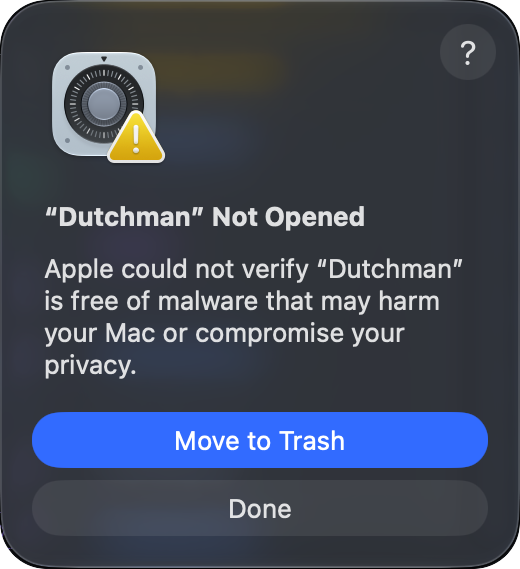
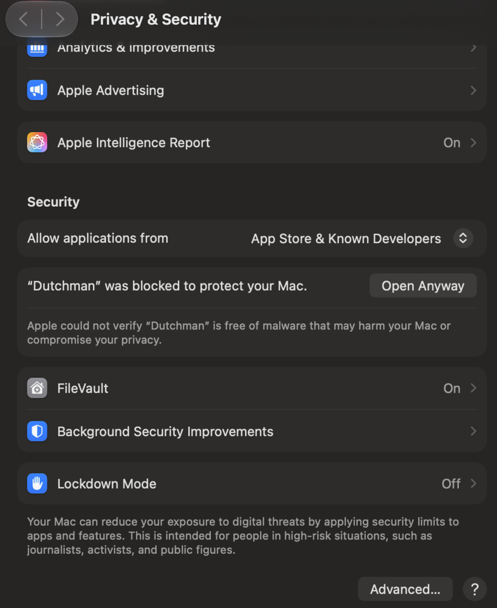

# Getting started

Dutchman converts native CAD files into [SolidCraft](https://github.com/tangency-labs/solidcraft)
designs (`.solidcraft`). This guide covers installing it, converting your first design,
reading what the conversion reports, and opening the result in SolidCraft.

- [Install](#install)
- [Your first conversion](#your-first-conversion)
- [Look before you convert: inspect](#look-before-you-convert-inspect)
- [Convert a whole folder: convert-all](#convert-a-whole-folder-convert-all)
- [Formats](#formats)
- [Reading the loss report](#reading-the-loss-report)
- [Feature history and the SolidCraft check](#feature-history-and-the-solidcraft-check)
- [Open the result in SolidCraft](#open-the-result-in-solidcraft)
- [Troubleshooting](#troubleshooting)

## Install

### macOS: the app

From 0.1.3 on, each release has `dutchman-VERSION-macos-universal.dmg`: **Dutchman.app**, for
Apple silicon and Intel Macs alike, with the `dutchman` and `dutchman-mcp` commands inside it.

1. Open the disk image and drag **Dutchman** onto **Applications**.
2. Open Dutchman from Applications.

#### Opening the app the first time

Dutchman is not signed with an Apple Developer ID, so the first time you open it macOS stops
it with this box:



Click **Done**, not Move to Trash, then:

1. Open **System Settings** › **Privacy & Security**.
2. Scroll down to **Security**. It says “Dutchman” was blocked to protect your Mac.
3. Click **Open Anyway**, enter your password, then click **Open Anyway** in the box that
   follows.



macOS remembers the choice; from then on Dutchman opens like any other app. Right-click ›
Open, which older macOS versions offered, no longer gets past the box.

Or clear the download's quarantine flag once, in Terminal:

```sh
xattr -dr com.apple.quarantine /Applications/Dutchman.app
```

The app is signed ad hoc, so macOS never calls it “damaged”. If it does, the download was
cut short or changed: download it again and check it against its `.sha256`
(`shasum -a 256 -c dutchman-VERSION-macos-universal.dmg.sha256`).

To use the commands from Terminal, link them onto your `PATH`:

```sh
sudo ln -sf /Applications/Dutchman.app/Contents/Helpers/dutchman /usr/local/bin/dutchman
sudo ln -sf /Applications/Dutchman.app/Contents/Helpers/dutchman-mcp /usr/local/bin/dutchman-mcp
```

### From a release archive

Each [release](https://github.com/dutchman-cad/dutchman/releases) has one archive per
platform. Each archive holds `dutchman` (the command), `dutchman-mcp` (the
[MCP server](mcp.md)), `dutchman-gui` (the desktop app, from 0.1.1 on), `LICENSE`, `NOTICE`,
`README.md` and the font licences, with a `.sha256` file beside it.

| Platform | Archive |
|---|---|
| Linux, x86_64 | `dutchman-VERSION-x86_64-unknown-linux-gnu.tar.gz` |
| Linux, ARM64 | `dutchman-VERSION-aarch64-unknown-linux-gnu.tar.gz` |
| macOS, Apple silicon | `dutchman-VERSION-aarch64-apple-darwin.tar.gz` |
| macOS, Intel | `dutchman-VERSION-x86_64-apple-darwin.tar.gz` |
| Windows, x86_64 | `dutchman-VERSION-x86_64-pc-windows-msvc.zip` |

Download the archive and its `.sha256` file, check one against the other, then unpack it and
put the programs on your `PATH`. On Linux x86_64, for release 0.1.4 (set `VERSION` and the
target for another release or machine):

```sh
VERSION=0.1.4 TARGET=x86_64-unknown-linux-gnu
base=https://github.com/dutchman-cad/dutchman/releases/download/v$VERSION
curl -fLO "$base/dutchman-$VERSION-$TARGET.tar.gz"
curl -fLO "$base/dutchman-$VERSION-$TARGET.tar.gz.sha256"
sha256sum -c dutchman-$VERSION-$TARGET.tar.gz.sha256
tar xzf dutchman-$VERSION-$TARGET.tar.gz
mkdir -p "$HOME/.local/bin"
install -m 755 dutchman-$VERSION-$TARGET/dutchman* "$HOME/.local/bin/"
export PATH="$HOME/.local/bin:$PATH"
dutchman --version
```

The `export` lasts for this shell; add the same line to your shell's profile (`~/.bashrc`,
`~/.zshrc`) to keep it. The `dutchman*` pattern installs the desktop app, `dutchman-gui`, too.

On macOS, `shasum -a 256 -c` takes the place of `sha256sum -c`. The programs are not signed
with a Developer ID, so macOS blocks each the first time, as it does
[the app](#opening-the-app-the-first-time); allow it in System Settings › Privacy & Security,
or clear the quarantine flag:

```sh
xattr -d com.apple.quarantine dutchman dutchman-mcp dutchman-gui
```

On Windows, in PowerShell, compare the hash with the one in the `.sha256` file, then unpack
the archive and add its folder to your `PATH`:

```powershell
Get-FileHash dutchman-VERSION-x86_64-pc-windows-msvc.zip -Algorithm SHA256
Get-Content dutchman-VERSION-x86_64-pc-windows-msvc.zip.sha256
Expand-Archive dutchman-VERSION-x86_64-pc-windows-msvc.zip -DestinationPath .
```

### Channels: stable and nightly

- **Stable** releases (`v0.1.4`, …) are the ones to use. Each is built against released
  versions of cadmpeg, the library that reads the native files.
- **Nightly** is one pre-release, [`nightly`](https://github.com/dutchman-cad/dutchman/releases/tag/nightly),
  rebuilt each day from Dutchman's latest code against cadmpeg's latest code, and published
  only when every test passes. Its notes give both commits and the date. Its archives are
  named `dutchman-nightly-TARGET` and install the same way. Use it when an issue says a fix is
  merged but not released yet; go back to stable once a stable release has it.

### From source

With Rust 1.88 or newer:

```sh
cargo install --git https://github.com/dutchman-cad/dutchman dutchman
```

This installs both `dutchman` and `dutchman-mcp`. Check the install:

```sh
dutchman --version
```

### SolidCraft (optional, recommended)

When a design's feature history converts, Dutchman checks it by replaying it in SolidCraft's
command-line tool, `solidcraft-cli`, which comes with every
[SolidCraft release](https://github.com/tangency-labs/solidcraft/releases). Installing the
SolidCraft app is enough: Dutchman finds the tool inside it (on macOS, the newest
`SolidCraft*.app` in `/Applications` or `~/Applications`; on Windows, `Program Files\SolidCraft`).
`--solidcraft PATH`, `SOLIDCRAFT_CLI`, or `solidcraft-cli` on your `PATH` come first. The
desktop app says which one it checks with. Without one, conversions still work; a converted
history is marked unverified.

Dutchman's designs open in **SolidCraft 0.18.2 or newer**, and are tested with 0.18.2 and
0.19.0. A `solidcraft-cli` older than 0.18.2 is not used: the conversion says so ("… is older
than SolidCraft 0.18.2, the oldest that opens and checks Dutchman's designs; install a newer
SolidCraft") and writes the history unverified. SolidCraft 0.19.0 saves designs in a newer
format that older versions do not open, so a design you save again in 0.19.0 opens in 0.19.0
or newer only.

## Your first conversion

You need a native CAD file. Dutchman has no public sample designs yet, but its tests use
small synthetic files that are fine to try: they are in
[`crates/dutchman-core/tests/fixtures/`](../crates/dutchman-core/tests/fixtures/), with
where each came from in that folder's README. None is a real design. `solidworks_cube.sldprt`
is a 10 mm cube; `generated_unit_cube.f3d` and `synthetic_cube.ipt` are the same cube as
Fusion and Inventor files. To download them:

```sh
fixtures=https://raw.githubusercontent.com/dutchman-cad/dutchman/main/crates/dutchman-core/tests/fixtures
curl -fLO "$fixtures/solidworks_cube.sldprt"
curl -fLO "$fixtures/generated_unit_cube.f3d"
curl -fLO "$fixtures/synthetic_cube.ipt"
```

```sh
dutchman convert solidworks_cube.sldprt cube.solidcraft
```

```text
converted  solidworks_cube.sldprt -> cube.solidcraft (geometry without history)
dutchman: Degraded: sldprt/source.dialect-unverified: the document carries no swSolidWorks swVersion declaration, so no declared identity was verified. …
dutchman: Degraded: sldprt/config.inferred-without-native: 1 configuration state(s) are inferred from geometry partitions without native configuration definitions.
dutchman: Info: step/design.parametric-records-omitted: 1 parametric/design record(s) were not represented in STEP: configuration=1
dutchman: Info: step/native.passthrough-record-omitted: 1 uninterpreted passthrough record(s) were not represented in STEP
dutchman: Info: history: flattened: the design carries no feature history
dutchman: (notes are cut to their first sentence; --verbose prints them in full)
```

The exit code is 0, and the first line, on stdout, says what was written where: here the
geometry, as this file has no feature history (else `editable history, verified in SolidCraft`
or `editable history, unverified`). The lines on stderr are the loss report, explained
[below](#reading-the-loss-report). Long notes are cut to their first sentence, marked `…`;
`--verbose` prints them whole. An existing output file is
replaced (`--no-clobber` keeps it, and the conversion fails instead), and nothing is written
when the conversion fails.

The output must end in `.solidcraft`. To get one machine-readable report on stdout instead
of the text, add `--json` ([json.md](json.md) describes every field):

```sh
dutchman convert --json generated_unit_cube.f3d cube.solidcraft
```

```json
{"history":{"features":[],"mapped":0,"total":0},
 "input":{"format":"fusion_archive","format_name":"Fusion archive (.f3d)","path":"generated_unit_cube.f3d"},
 "losses":[
  {"code":"f3d/material.not-transferred","level":"Degraded","message":"Materials/appearances (.protein assets, ACT/design assignments) were not transferred.","subject":"f3d/material.not-transferred"},
  {"code":"step/attribute.source-record-not-written","level":"Info","message":"7 source attribute record(s) were not written to STEP","subject":"step/attribute.source-record-not-written"},
  {"code":"step/native.source-record-omitted","level":"Info","message":"45 source-native record(s) were not represented in STEP","subject":"step/native.source-record-omitted"},
  {"code":null,"level":"Info","message":"flattened: the design carries no feature history","subject":"history"}],
 "mode":"import","ok":true,
 "output":{"format":"solidcraft/23","path":"cube.solidcraft"},
 "schema":"dutchman.convert/1",
 "verification":{"reason":"the design carries no feature history","status":"not_applicable"}}
```

(Printed on one line; wrapped here.)

### Options

| Option | What it does |
|---|---|
| `--import-only` | Write the geometry as one non-parametric import, never the feature history. |
| `--solidcraft PATH` | The `solidcraft-cli` that checks a converted history. Default: `$SOLIDCRAFT_CLI`, else `solidcraft-cli` on `PATH`, else the one inside an installed SolidCraft app (macOS `SolidCraft*.app`, newest first; Windows `Program Files\SolidCraft`). |
| `--no-verify` | Write the history without checking it in SolidCraft. Cannot be combined with `--solidcraft`. |
| `--verify-timeout SECONDS` | How long each SolidCraft check may run before the history is written unverified. Default 120. |
| `--no-clobber` | Do not replace an existing `.solidcraft` file: that file's conversion fails instead. By default it is replaced. |
| `--project DIR` | The project folder an Inventor assembly's part files are searched in when they are not at their stored paths. Default: the nearest folder above the assembly holding an `.ipj`, else two folders up. See [Finding the part files](inventor.md#finding-the-part-files). |
| `--search DIR` | Another folder to search for part files the project folder does not hold, such as a shared library. May be given more than once. |
| `--json` | One JSON report on stdout instead of the text report. |
| `--verbose` | Print every loss, each note in full. Without it, a file with more than 12 losses is summarised by component (below), and long notes are cut to their first sentence. The JSON report always has them all in full. |
| `--log FILE` | Also write the whole text report, every loss in full, grouped by component, to `FILE`. |

## Look before you convert: inspect

`inspect` reads a file and says what converting it would carry across. It writes nothing and
does not run SolidCraft.

`design_sketch_constraints.f3d`, from the same folder, is for inspecting only: its history is a
single sketch, with no solid or surface to convert.

```sh
dutchman inspect design_sketch_constraints.f3d
```

```text
Fusion archive (.f3d): 1 body, 1 face
would write: nothing; converting it fails: the model has no solids or surfaces SolidCraft can import
  mapped     sketch "Sketch 1"
dutchman: Degraded: f3d/feature.edge-reference-lost: 1 source parametric edge reference(s) were marked EDGE_REFERENCE_LOST and have no independent complete selection proof.
dutchman: Degraded: f3d/sketch.relation-native: 2 sketch relation(s) retain native operands because no unique neutral relation was resolved.
dutchman: Degraded: f3d/sketch.dimension-native: 1 sketch dimension(s) retain native operands because no unique neutral dimension was resolved.
```

The first line counts the bodies and faces read. The second says whether the design would keep
its feature history or be written as geometry, and why, or, as here, that converting it would
fail and why. Then comes each feature of the history
with its status (`mapped`, `not_needed`, `left_out` or `blocked`, with the reason for a
blocked one), and the loss report. `inspect --json` prints the same as a
`dutchman.inspect/1` report.

## Convert a whole folder: convert-all

`convert-all` converts every file named, and every file Dutchman knows inside the folders
named (with their subfolders; symbolic links are not followed). The designs go to
`--out-dir`, keeping the folder layout. A file that fails does not stop the others.

```sh
dutchman convert-all --jobs 2 --out-dir converted project
```

```text
converted  project/generated_unit_cube.f3d -> converted/generated_unit_cube.solidcraft (geometry without history)
           Degraded: f3d/material.not-transferred: Materials/appearances (.protein assets, ACT/design assignments) were not transferred.
           Info: step/attribute.source-record-not-written: 7 source attribute record(s) were not written to STEP
           Info: step/native.source-record-omitted: 45 source-native record(s) were not represented in STEP
           Info: history: flattened: the design carries no feature history
failed     project/sub/container_metadata_only.f3d: cannot read this design: no geometry could be read from this Fusion archive (.f3d) file
converted  project/sub/synthetic_cube.ipt -> converted/sub/synthetic_cube.solidcraft (geometry without history)
           Degraded: inventor/rse.segment-pair-untyped: Retained 1 structurally paired RSe segment(s) without record semantics.
           Info: step/attribute.source-record-not-written: 7 source attribute record(s) were not written to STEP
           Info: step/native.source-record-omitted: 67 source-native record(s) were not represented in STEP
           Info: history: flattened: the design carries no feature history
2 converted, 1 failed, 1 skipped (not in a format Dutchman knows)
```

Each converted file's loss report is listed beneath it, summarised by component when it has
more than 12 losses. The whole report, every loss in full, is written to `dutchman.log` in the
output folder (`--log FILE` puts it elsewhere): attach it to an issue rather than copying
lines. Files in the folders that are not in a format Dutchman knows (`notes.txt`, say) are
skipped and counted at the end. The exit code is 0
only when every file converted, else 1. `--jobs N` sets how many files
convert at once (default: the machine's cores, at most 8). It takes the same options as
`convert`, and `--json` prints one `dutchman.convert-all/1` report holding a
`dutchman.convert/1` report per file. One run converts at most 10,000 files and searches
folders at most 32 levels deep.

Large batches:

- **Each file in its own process.** A file that takes longer than `--timeout SECONDS` (default
  900) or holds more than `--max-memory MB` (default 8192; `0` for no limit) is stopped and
  reported as failed, and the rest carry on. A file that crashes the converter fails alone.
- **Carry on where you stopped.** `--journal FILE` records each file's result as it finishes.
  Run the same command again and the files already recorded, unchanged since, are not
  converted again; their results come from the journal. Files another version of Dutchman
  recorded, or an older journal format (before 0.1.4), are converted again.
- **A report you can share.** `--report-anon FILE` also writes an anonymous report: counts by
  format, every loss and failure by cause and stage, and timings, with no file names, paths or
  geometry. See [Testing Dutchman on your library](testing-your-library.md) and
  [the report's fields](report-anon.md).

Everything runs on your machine: Dutchman makes no network connections.

For an Inventor assembly (`.iam`), Dutchman finds its part files as Inventor does: at the
paths it stores, else anywhere under the project folder, the nearest folder above it holding a
`.ipj`. Give another with `--project DIR`; `convert-all` searches each folder it is given. See
[Finding the part files](inventor.md#finding-the-part-files).

## Formats

```sh
dutchman formats
```

```text
Fusion archive (.f3d)            converts  geometry; feature history (sketches, constraints, dimensions, extrudes, revolves, lofts, sweeps, spheres, tori, coils) when every feature maps; components when the file says which bodies they own
Fusion multi-document archive (.f3z) converts  as a Fusion archive, with the designs it references merged in by cadmpeg
Inventor part (.ipt)             converts  geometry; feature history waits on cadmpeg resolving extrude profiles
Inventor assembly (.iam)         converts  placed parts and sub-assemblies, read from their files in the project
SolidWorks part (.sldprt)        converts  geometry; feature history waits on cadmpeg binding sketches and extrude profiles
SolidWorks assembly (.sldasm)    not yet   nothing yet
FreeCAD document (.FCStd)        not yet   in nightly builds for now: https://github.com/dutchman-cad/dutchman/releases/tag/nightly
```

The state of each format, and what is still missing upstream, is in [fusion.md](fusion.md),
[inventor.md](inventor.md), [sldprt.md](sldprt.md) and [freecad.md](freecad.md). Reading
native files is done by
[cadmpeg](https://github.com/cadmpeg/cadmpeg); a format improves in Dutchman when it improves
there.

## Reading the loss report

An assembly's conversion first says how complete it is, under the line saying what was
written:

```text
converted  top.iam -> out/top.solidcraft (geometry without history)
assembly: 18 of 20 placements placed; 2 left out:
  pin.ipt ×2: not found at its stored path or in the project folder /work/Robot
```

The count takes in every placement the assembly and its sub-assemblies record, each
sub-assembly as often as it is placed. Each cause names the file and how many placements it
cost. A part not found usually means its project folder is elsewhere: give it with
`--project`, or a library with `--search` (see
[Finding the part files](inventor.md#finding-the-part-files)). `inspect` says the same as
`would place: …`.

Every conversion lists what it could not carry across intact. A design with more than 12
losses, an assembly's usually, gets them by component instead, the design itself first, then
the parts with the most that matters:

```text
losses: 182 in 14 components
  the design: 1 Degraded, 3 Info
  pin.ipt: 1 Dropped
  base.ipt: history flattened (feature "Fillet1": fillet is not mapped yet); 2 Degraded, 9 Info
  …
```

`--verbose` prints every line, and `--log FILE` writes them all to a file. In the desktop app,
each part's losses fold away under its own heading, and **Save the full log…** writes them
out.

Each loss line reads `LEVEL: SUBJECT: MESSAGE`:

| Level | Meaning | What to do |
|---|---|---|
| `Info` | No effect on the geometry. Something was left out that SolidCraft does not use, or the line just says what happened. | Nothing. |
| `Degraded` | Carried across in a weaker form. | Check that part of the design in SolidCraft. |
| `Dropped` | Left out of the design. | Compare with the original; redraw what is missing, or convert again when Dutchman or cadmpeg supports it. |

Lines from the examples above, in plain words:

- `Info: history: flattened: the design carries no feature history`: the file has no
  history to convert, so the design is the solid geometry alone.
- `Info: step/native.source-record-omitted: 45 source-native record(s) were not represented
  in STEP`: internal records of the native file that have no place in the converted geometry.
  The shape is not affected.
- `Degraded: f3d/material.not-transferred: Materials/appearances … were not transferred.`:
  the shape converted, but the materials did not. Set them again in SolidCraft.
- `Degraded: f3d/sketch.dimension-native: 1 sketch dimension(s) retain native operands …`:
  a sketch dimension could not be tied to the sketch geometry it measures. The sketch is at
  the right size, but that dimension may not drive it.

`Dropped` lines name what was left out. For example, a part in an Inventor assembly whose
file cannot be found is reported as `Dropped: <part>: its part is not in a separate file
Dutchman can find`, and the rest of the assembly still converts.

The first part of a subject such as `f3d/material.not-transferred` is a stable code from
cadmpeg; in `--json` it is the `code` field, which scripts can match on.

## Feature history and the SolidCraft check

When every feature in a design's history maps onto SolidCraft (sketches, extrudes, revolves
and patterns so far), the design keeps that history, editable, with the original geometry
kept beside it as a suppressed import named "Original geometry (imported)". Otherwise the
design is the geometry alone, and the report says which feature stopped the history.

A converted history is checked by replaying it in `solidcraft-cli` and comparing the bodies
and their volumes with the original. The result is in the `history:` line of the report, and
in `verification.status` in `--json`:

| Status | Meaning |
|---|---|
| `verified` | The history replays in SolidCraft and matches the original. |
| `unverified` | The history was written without the check: no `solidcraft-cli` was found, it timed out, or `--no-verify`. The reason is given. |
| `flattened` | The design has a history, but it was not written: a feature does not map, or the replay differs from the original. The design is the geometry alone. |
| `not_applicable` | There was no history to write, or `--import-only`. |

When the design is written as geometry, the same `solidcraft-cli` opens it too. If SolidCraft
shows fewer faces than the source model has, or warns about it (for example faces it cannot
mesh), the report says so as `Degraded: geometry: …`, such as
`Degraded: geometry: SolidCraft opens 3 of the 6 faces converted: 3 faces are missing there; solid 'unit cube': 3 face(s) could not be meshed and are not shown`.
The geometry was written whole; SolidCraft does not show all of it. Look over those bodies in
SolidCraft before relying on them. When SolidCraft says why, the reason follows (faces it
cannot mesh, open shells, bodies inside out). `--no-verify`
skips this check too.

## Open the result in SolidCraft

In the SolidCraft app, use File, Open, or start it with the design:

```sh
solidcraft cube.solidcraft
```

From the command line, `solidcraft-cli eval` opens the design, rebuilds its timeline and
prints its bodies as JSON:

```sh
solidcraft-cli eval cube.solidcraft
```

Check that `body_count` is what you expect, that no `timeline` entry has an `error` or a
`warning`, and that each body's `volume_mm3` and `bbox` match the original design. An AI
agent can do the same through SolidCraft's MCP server: open the design with
`solidcraft-cli mcp --in cube.solidcraft` and call its `measure` tool.

## Troubleshooting

Every error is one line on stderr, and the exit code is 1 (2 for a mistake on the command
line). Nothing is written when a conversion fails.

| Message | What to do |
|---|---|
| `x.step: output must be a .solidcraft file` | Name the output `something.solidcraft`. |
| `a.step: Dutchman does not convert this kind of file. It converts …` | Dutchman converts the native formats listed; it does not read STEP or other exchange formats. Open STEP files in SolidCraft directly. |
| `SolidWorks assembly (.sldasm) files are not supported yet. Export a STEP file for SolidCraft to open; Dutchman's issues (…) say when …` | Export the assembly as STEP from the program that made it and open that in SolidCraft. |
| `cannot read this design: its contents are inventor data, not Fusion archive (.f3d); rename it to match` | The file's extension does not match its contents. Rename it with the right extension. |
| `cannot read this design: no geometry could be read from this Fusion archive (.f3d) file` | The file holds no geometry Dutchman can read yet, for example a design saved without bodies, or one whose geometry is stored in a form cadmpeg does not read yet. |
| `cannot read this design: malformed container: …` | The file is cut short or damaged, for example by an unfinished download or copy. Get a fresh copy. If the original opens in the program that made it, please report it. |
| `cannot convert this design: the model has no solids or surfaces SolidCraft can import` | The file was read but held nothing SolidCraft can hold as a solid or surface. |
| `missing.f3d: No such file or directory (os error 2)` | Check the path. |
| `part.f3d: the file is … bytes, over Dutchman's 1073741824-byte limit` | Dutchman opens files up to 1 GiB. |
| `history: …; unverified: …` | Not an error: the history was written without the SolidCraft check. Install `solidcraft-cli`, or point `--solidcraft` or `SOLIDCRAFT_CLI` at it, and convert again. |
| `history: flattened: replay differs (…)` | Not an error: the history did not rebuild the same shape in SolidCraft, so the geometry was written instead. `--no-verify` keeps the history, unchecked. |

A design that converts but looks wrong in SolidCraft is worth a report. Please open an issue
with the loss report and, if you can share it, a small file that shows the problem. Only
share files you made yourself and are free to share.
