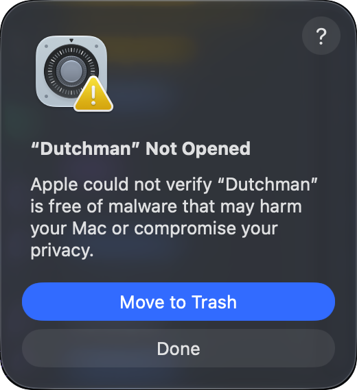
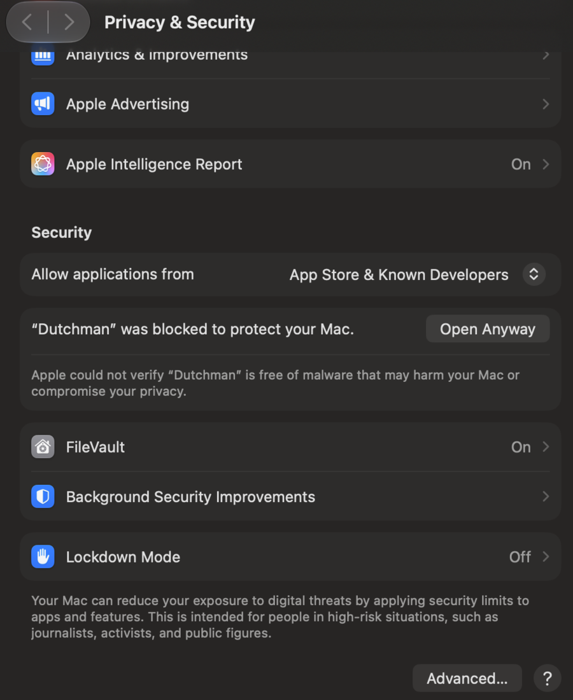
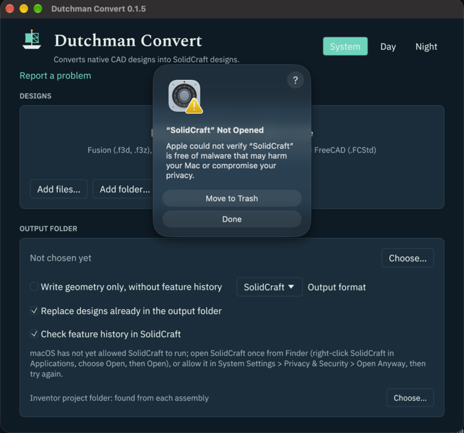

# Install

Dutchman installs as three programs: `dutchman` (the command line), `dutchman-mcp` (the MCP server), and `dutchman-gui` (the desktop app, Dutchman Convert). Release archives, the Windows installer, the macOS disk image, Homebrew, and Scoop install all three; `cargo install` and Docker leave out the desktop app.

## Included guidance

Every release archive (including the Windows ZIP) includes `skills/`, the `docs/` Markdown,
and a short top-level `AGENTS.md` for assistants started in the install folder. The MSI
installs them under `%LOCALAPPDATA%\Programs\Dutchman` and removes them on uninstall.
The macOS app keeps them in `Dutchman Convert.app/Contents/Resources`; its installed guide
points to the commands in `Contents/Helpers`.
The skill includes all its local resources and referenced documentation. The guide explains
saved `<stem>.report.json` reports and commands run by the full path in that folder.

All Markdown docs and images up to 256 KiB are included. Larger images and non-Markdown
examples are omitted; links to repository source or generated reproduction kits still
refer to those sources. Keep the whole unpacked folder when installing an archive, so
these guides stay beside the programs. Portable Windows updates refresh them too.

## Windows: the installer

Download `dutchman-VERSION-x86_64-pc-windows-msvc.msi` and its `.msi.sha256` from the
[latest release](https://github.com/dutchman-cad/dutchman/releases/latest). The README links
the same files under versionless names. Check the hash in PowerShell before opening it:

```powershell
Get-FileHash dutchman-VERSION-x86_64-pc-windows-msvc.msi -Algorithm SHA256
Get-Content dutchman-VERSION-x86_64-pc-windows-msvc.msi.sha256
```

The installer needs no administrator rights. It installs `dutchman-gui.exe`, `dutchman.exe`,
and `dutchman-mcp.exe` in `%LOCALAPPDATA%\Programs\Dutchman`, adds that folder to your user
PATH, and adds **Dutchman Convert** to Start. Open a new terminal to use `dutchman --version`.
Installed apps shows **Dutchman Convert**, its version, publisher **Dutchman CAD**, and icon.
Newer installers upgrade this copy in place; older versions are refused. Uninstall through
Windows Settings removes the programs, shortcut, and PATH entry, and keeps
`%LOCALAPPDATA%\Dutchman` (including diagnostic logs) and the app's versioned settings in
`%APPDATA%\Dutchman Convert VERSION\data`.

The [portable ZIP](#from-a-release-archive) remains available beside the installer. Choose
one installation method; Scoop installations continue to update through Scoop.

### Windows first run

Dutchman Convert's Windows installer and programs are unsigned. SmartScreen may stop the
first launch with **Windows protected your PC**:

1. Click **More info**.
2. Click **Run anyway**.

Windows remembers the approval for that download. A new version may ask again.

## Homebrew or Scoop

On macOS or Linux with [Homebrew](https://brew.sh):

```sh
brew install dutchman-cad/tap/dutchman
```

On Windows with [Scoop](https://scoop.sh):

```powershell
scoop bucket add dutchman-cad https://github.com/dutchman-cad/scoop-bucket
scoop install dutchman-cad/dutchman
```

Either installs `dutchman`, `dutchman-mcp`, and the desktop app, `dutchman-gui` (Scoop also adds
a **Dutchman Convert** Start menu shortcut), on your `PATH`. `brew upgrade` or `scoop update`
brings each new release, usually within an hour of it. Homebrew pours a ready-made bottle, so
it needs no Xcode or Command Line Tools. On macOS the commands Homebrew installs open without
the first-run approval below, because Homebrew's downloads are not quarantined.

On macOS, Homebrew also installs the app, **Dutchman Convert.app**, in Applications and
Launchpad:

```sh
brew install --cask dutchman-cad/tap/dutchman-convert
```

Homebrew quarantines the apps it installs, so the app needs the
[first-run approval](#opening-the-app-the-first-time) once, as from the disk image.
[Pilot](https://github.com/dutchman-cad/pilot) installs the same way, as `dutchman-pilot`
(`brew install dutchman-cad/tap/dutchman-pilot`, `scoop install dutchman-cad/dutchman-pilot`).

## macOS: the app

From 0.1.3 on, each release has `dutchman-VERSION-macos-universal.dmg`: **Dutchman
Convert.app** (named **Dutchman.app** in 0.1.5 and earlier), for Apple silicon and Intel Macs
alike, with the `dutchman` and `dutchman-mcp` commands inside it.

1. Open the disk image and drag **Dutchman Convert** onto **Applications**.
2. Open it from Applications or Launchpad, where it is shown as **Dutchman** (the file is
   `Dutchman Convert.app`).

### Opening the app the first time

Dutchman Convert is not signed with an Apple Developer ID, so the first time you open it macOS
stops it with this box:



Click **Done**, not Move to Trash, then:

1. Open **System Settings** › **Privacy & Security**.
2. Scroll down to **Security**. It says “Dutchman” was blocked to protect your Mac.
3. Click **Open Anyway**, enter your password, then click **Open Anyway** in the box that
   follows.



macOS remembers the choice; from then on Dutchman Convert opens like any other app. Right-click ›
Open, which older macOS versions offered, no longer gets past the box.

Or clear the download's quarantine flag once, in Terminal:

```sh
xattr -dr com.apple.quarantine "/Applications/Dutchman Convert.app" 2>/dev/null || true
```

The app is signed ad hoc, so macOS never calls it “damaged”. If it does, the download was
cut short or changed: download it again and check it against its `.sha256`
(`shasum -a 256 -c dutchman-VERSION-macos-universal.dmg.sha256`).

The commands inside the app (`dutchman`, `dutchman-mcp`) are covered by the same approval.
Run before it, from Terminal, they meet the same box: approve the app once, as above, and they
run too.

To use the commands from Terminal, link them onto your `PATH`:

```sh
sudo ln -sf "/Applications/Dutchman Convert.app/Contents/Helpers/dutchman" /usr/local/bin/dutchman
sudo ln -sf "/Applications/Dutchman Convert.app/Contents/Helpers/dutchman-mcp" /usr/local/bin/dutchman-mcp
```

With 0.1.5 or earlier, write `/Applications/Dutchman.app` in these commands instead.

## From a release archive

Each [release](https://github.com/dutchman-cad/dutchman/releases) has archives for the
platforms below. Each archive holds `dutchman` (the command), `dutchman-mcp` (the
[MCP server](mcp.md)), `dutchman-gui` (the desktop app, from 0.1.1 on), `LICENSE`, `NOTICE`,
`README.md` and the font licences, with a `.sha256` file beside it.

| Platform | Archive |
|---|---|
| Linux, x86_64 | `dutchman-VERSION-x86_64-unknown-linux-gnu.tar.gz` |
| Linux, ARM64 | `dutchman-VERSION-aarch64-unknown-linux-gnu.tar.gz` |
| macOS, Apple silicon or Intel | `dutchman-VERSION-macos-universal.tar.gz` |
| macOS, Apple silicon (per-chip archive) | `dutchman-VERSION-aarch64-apple-darwin.tar.gz` |
| macOS, Intel (per-chip archive) | `dutchman-VERSION-x86_64-apple-darwin.tar.gz` |
| Windows, x86_64 | `dutchman-VERSION-x86_64-pc-windows-msvc.zip` |

The universal macOS archive runs on both Apple silicon and Intel. Per-chip archives remain
available for Homebrew and other installations that select a processor. The README's download
table links the latest release's universal archive and disk image.

Download the archive and its `.sha256` file, check one against the other, then unpack it and
put the programs on your `PATH`. On Linux x86_64, for release 0.2.6 (set `VERSION` and the
target for another release or machine):

```sh
VERSION=0.2.6 TARGET=x86_64-unknown-linux-gnu
base=https://github.com/dutchman-cad/dutchman/releases/download/v$VERSION
curl -fLO "$base/dutchman-$VERSION-$TARGET.tar.gz"
curl -fLO "$base/dutchman-$VERSION-$TARGET.tar.gz.sha256"
sha256sum -c dutchman-$VERSION-$TARGET.tar.gz.sha256
tar xzf dutchman-$VERSION-$TARGET.tar.gz
mkdir -p "$HOME/.local/bin"
mkdir -p "$HOME/.local/lib/dutchman"
cp -R dutchman-$VERSION-$TARGET/. "$HOME/.local/lib/dutchman/"
for program in dutchman dutchman-mcp dutchman-gui dutchman-web; do
  ln -sfn "$HOME/.local/lib/dutchman/$program" "$HOME/.local/bin/$program"
done
export PATH="$HOME/.local/bin:$PATH"
dutchman --version
```

The `export` lasts for this shell; add the same line to your shell's profile (`~/.bashrc`,
`~/.zshrc`) to keep it. The complete release folder keeps the desktop app and local guidance together.

On Linux, launch the desktop app with `dutchman-gui` from a terminal. It needs an X11 or
Wayland desktop session with working OpenGL. See [Troubleshooting](troubleshooting.md) if no
window appears.

On macOS, download the latest universal archive and its checksum, check it, and unpack it.
All three programs run on Apple silicon and Intel:

```sh
base=https://github.com/dutchman-cad/dutchman/releases/latest/download
curl -fLO "$base/dutchman-macos-universal.tar.gz"
curl -fLO "$base/dutchman-macos-universal.tar.gz.sha256"
shasum -a 256 -c dutchman-macos-universal.tar.gz.sha256
tar xzf dutchman-macos-universal.tar.gz
```

The archive unpacks to `dutchman-<version>-macos-universal/`. In a folder containing just
this unpacked release, install its programs and run the command:

```sh
cd dutchman-*-macos-universal
xattr -dr com.apple.quarantine . 2>/dev/null || true
mkdir -p "$HOME/.local/bin"
mkdir -p "$HOME/.local/lib/dutchman"
cp -R . "$HOME/.local/lib/dutchman/"
for program in dutchman dutchman-mcp dutchman-gui; do
  ln -sfn "$HOME/.local/lib/dutchman/$program" "$HOME/.local/bin/$program"
done
export PATH="$HOME/.local/bin:$PATH"
dutchman --version
dutchman --help
```

Add the `export` line to `~/.zshrc` to keep it for new terminals. Clearing quarantine is
quiet and succeeds when there is no flag, including downloads made with curl. If macOS
blocks a program, you can also allow it in System Settings › Privacy & Security, as for
[the app](#opening-the-app-the-first-time).

On Windows, in PowerShell, compare the hash with the one in the `.sha256` file, then unpack
the archive and add its folder to your `PATH`:

```powershell
Get-FileHash dutchman-VERSION-x86_64-pc-windows-msvc.zip -Algorithm SHA256
Get-Content dutchman-VERSION-x86_64-pc-windows-msvc.zip.sha256
Expand-Archive dutchman-VERSION-x86_64-pc-windows-msvc.zip -DestinationPath .
```

## Channels: stable and nightly

- **Stable** releases (`v0.2.6`, …) are the ones to use. Each is built against one tested
  commit of cadmpeg, the library that reads the native files.
- **Nightly** is one pre-release, [`nightly`](https://github.com/dutchman-cad/dutchman/releases/tag/nightly),
  rebuilt each day from Dutchman's latest code against cadmpeg's latest code, and published
  only when every test passes. Its notes give both commits and the date. Its archives are
  named `dutchman-nightly-TARGET` and install the same way. Use it when an issue says a fix is
  merged but not in a release yet; go back to stable once a stable release has it.

## From source

With Rust 1.88 or newer:

```sh
cargo install --git https://github.com/dutchman-cad/dutchman dutchman
```

This installs both `dutchman` and `dutchman-mcp`. Check the install:

```sh
dutchman --version
```

## Docker

Each release is published as a container image with `dutchman`, `dutchman-mcp` and
`dutchman-web`, without the desktop app, for amd64 and arm64:
`docker pull ghcr.io/dutchman-cad/dutchman:latest`. The repository's `Dockerfile` builds the
same from source. [Docker](docker.md) says how to get it and convert with it.

## Dutchman Web, in a browser

`dutchman-web` serves a page that converts uploaded designs, for a Dutchman hosted on one
server and used from any browser. [Dutchman Web](web.md) says how to run it.

## SolidCraft (optional, recommended)

When a design's feature history converts, Dutchman checks it by replaying it in SolidCraft's
command-line tool, `solidcraft-cli`, which comes with every
[SolidCraft release](https://github.com/tangency-labs/solidcraft/releases). Installing the
SolidCraft app is enough: Dutchman finds the tool inside it (on macOS, the newest
`SolidCraft*.app` in `/Applications` or `~/Applications`; on Windows, `Program Files\SolidCraft`, else the install folder the installer recorded in the
registry). On Windows, the MSI installer and the portable ZIP include `solidcraft-cli.exe`; the
single-file `SolidCraft-…-windows-x64.exe` download does not.
`--solidcraft PATH`, `SOLIDCRAFT_CLI`, or `solidcraft-cli` on your `PATH` or beside Dutchman come first. The
desktop app says which one it checks with, and **Choose solidcraft-cli…** in its
[SolidCraft version panel](desktop.md#solidcraft-version) picks one and remembers it. Without one, conversions still work; a converted
history is marked unverified.

On macOS, let SolidCraft itself run once before the first check: open SolidCraft from
Applications, click **Done** when macOS stops it, then click **Open Anyway** in **System
Settings > Privacy & Security**, the same steps as for Dutchman Convert. Dutchman reads the
app's quarantine attribute and its user-approved flag without changing them. The desktop app
retries a blocked check when its window regains focus or you start a conversion. Until then
it says so under the check option:



Dutchman is made for the current SolidCraft (any release from the last two weeks);
older versions get simplified features, or pass `--solidcraft-version x.y.z` on
`convert`, `convert-all`, or `watch`. The current window is 0.18.2–0.41; roundtrip
checks cover its oldest and newest releases. Each design targets the found CLI's version,
even with `--no-verify`, else the newest release known at build time (currently 0.41).
Versions below 0.18.2 and malformed versions are refused. Older targets remain accepted
down to 0.18.2. Features that need a newer release block history with a named reason
and preserve the original geometry as for other blockers.
A design opens in its target release and newer releases. A `solidcraft-cli` older than
0.18.2 is not used: the conversion says so ("… is older
than SolidCraft 0.18 patch 2, the oldest that opens and checks Dutchman's designs; install a newer
SolidCraft") and writes the history unverified. SolidCraft 0.19.0 saves designs in a newer
format that older versions do not open, so a design you save again in 0.19.0 opens in 0.19.0
or newer only.

## Building and packaging

```sh
cargo build --release
cargo test --workspace
```

For packagers: the std-only `dutchman-launcher` crate provides a tiny front command for
installations that ship with Pilot alone. Install its binary as `dutchman`;
`dutchman --version` identifies it as `dutchman launcher <version>`. Install Dutchman Convert
for the conversion commands.
