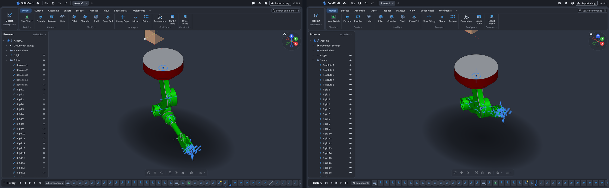

Dutchman Convert 0.2.7 adds a Windows installer that updates itself, fits the whole main window on one screen, and lets you ask your AI assistant about a converted file with no setup. Fusion assemblies get a choice of part positions and fewer false colour warnings. Its Fusion reader is cadmpeg 0.6.8, which reads the positions Fusion last displayed, and the Voron V1.8 and Voron 2.4 assemblies now convert within 16 GB.

## What's new

- **Windows installer.** Install Dutchman Convert without administrator rights, with a Start menu shortcut and the commands on your user PATH. The installer updates itself: choose Install, and Dutchman closes, installs a verified update, and starts again. Uninstalling keeps your settings and logs. The portable ZIP is still available, and Scoop copies keep updating with Scoop.
- **Everything on one screen.** The main window opens at a size that shows all of it, centred, with no scrolling. In a wide window, Designs and Output folder sit beside Results. Long results and long design lists scroll inside their own areas. A saved window size is restored, unless it is too small to use, and narrow windows keep every header control visible.
- **Ask your AI about a converted file.** Each conversion saves its full report beside the design. Copy a prompt from a result card, paste it into your assistant, and it can read the saved result without any MCP setup. Installed releases now include the agent skill, documentation, and a short AGENTS.md.
- **Part positions.** Fusion assemblies now default to Smart, which places parts where Fusion last showed them when joints, the model's extent, and repeated designs agree, and keeps shared sub-assemblies shared. You can also choose "As Fusion last showed them" (named after the program the file came from), or As first placed, in the app, on the command line, and over MCP.
- **Report problems with converted files.** Report lost features, wrong placement, or missing colours from a section on the result card. You review the exact anonymous details before anything is sent, and `dutchman report` does the same from the command line.
- **More accurate colours.** Fewer false "colour dropped" notes on Fusion assemblies, face colours land on the right faces, and body colours survive beside saved edges. Reports now count dropped colours by cause.
- **Large assemblies.** The Voron V1.8 and Voron 2.4 now convert, more Fusion revolves, mirrors, and drafts stay editable, large assemblies use less temporary memory, and memory estimates show each stage.

## Measured on SolidCraft 0.30

Same machine, same settings, one conversion at a time:

| Design | Parts placed | 0.2.6 time | 0.2.7 time | 0.2.6 peak memory | 0.2.7 peak memory |
|---|---:|---:|---:|---:|---:|
| Voron Trident | 1,697 of 1,697 | 8:16 | 3:18 | 17.2 GB | 10.5 GB |
| Voron 2.4 | 1,681 of 1,683 | 15:12 | 3:50 | 16.8 GB | 9.3 GB |
| Voron V1.8 | 1,220 of 1,222 | 8:54 | 6:55 | 18.5 GB | 11.5 GB |
| RailCore II 300ZL | 379 of 379 | | 1:37 | | 4.0 GB |
| RailCore II 300ZLT | 396 of 396 | | 1:57 | | 3.7 GB |

## Known issues

- SolidWorks mates are not converted, and most of a large SolidWorks assembly converts as geometry: on one public 88-component assembly, all 88 parts placed and about 13% of its features stayed editable. Some of its parts come through as rough surfaces, and a few of its part files fail when converted on their own.
- A Fusion design with Remove features can keep the removed bodies.
- The Voron Trident converts as geometry without editable history.
- The estimate before a conversion can still be well under the real peak on large assemblies; a run that won't fit stops early or skips the history check and says so.
- STEP comparison and `doctor` findings are advisory: their false-positive rate on large assemblies is not established.
- The RailCore timeline stays long on SolidCraft older than 0.30.
